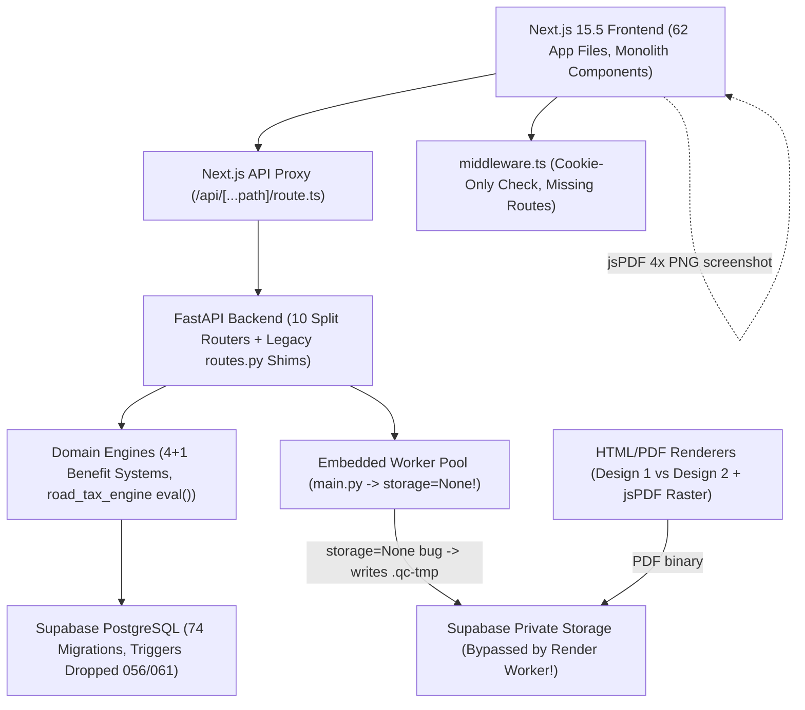
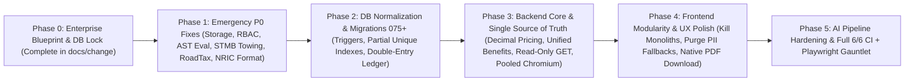

# Master Index & Enterprise Audit Roadmap: A-to-Z Site Inventory & Phased Remediation Plan

> **Code Freeze Notice**: Created under `v30.1` stabilization snapshot commit [`f8c410a`](file:///c:/Users/mahmud/Desktop/Code/risklocker/quote_risklocker/docs/change/00-git-checkpoint-log.md). All application source code (`backend/`, `frontend/`, `migrations/`, `tests/`, `commands/`, `.agents/`) remains **100% frozen** until every audit document in `docs/change/` is reviewed and approved.

---

## 1. Executive Orientation (Read This First)

Welcome to the A-to-Z architectural forensic map of the **Risklocker Quotation & Motor Insurance Operations Platform**. If you are a first-year software engineering student opening this repository for the first time, imagine the platform as five interconnected factories:

1. **Document Ingestion & AI Extraction (`backend/app/extraction/`, `workers/extraction_worker.py`)** — Takes raw insurer quotation PDFs or covernotes (Etiqa, Lonpac, QBE, Takaful Malaysia/STMB, AmAssurance, Berjaya Sompo, Tune Protect, Allianz), runs native PDF text parsing + OCR + Gemini Vision AI, and tries to normalize policy fields and benefits into a structured draft.
2. **Quotation Workspace & PDF Engine (`backend/app/services/workspace_*`, `generation_service.py`, `rendering/`, `workers/render_worker.py`, `frontend/src/components/session-workspace/`)** — Lets staff review, edit, toggle add-on cards (e.g., Windscreen, Special Perils, Unlimited Towing), preview Design 2 or custom templates, and archive/download an official PDF.
3. **Marketing Comparison & Motor Renewal Ledger (`backend/app/services/marketing_comparison_service.py`, `insurance_tenure_service.py`, `vehicle_tracking_service.py`, `frontend/src/components/comparison/`, `components/tenures/`)** — Tracks vehicles by plate/chassis across yearly insurance cycles (`InsuranceTenure`), compares multiple underwriter quotes side-by-side (`TenureComparisonEntry`), selects a winner, and advances the 12-stage renewal workflow.
4. **Master Configuration & Benefit Catalogs (`backend/app/services/business_setup_service.py`, `benefit_profile_service.py`, `benefit_setup_service.py`, `global_benefit_profile_service.py`, `frontend/src/app/builder/`)** — Admin studios for insurers, templates, logos/QR assets, road-tax schedules, and benefits.
5. **AI Copilot, Admin & Insights (`backend/app/services/copilot_chat_service.py`, `quotation_activity_service.py`, `auth_service.py`, `frontend/src/app/ai-context/`, `app/settings/`)** — Operational telemetry, conversion analytics, user management, and conversational AI tools.

**Why did this system require a total code freeze?**
Rapid, feature-by-feature iterations produced serious **dual-truth architectures** (the browser and backend calculate road tax, premiums, add-on cards, and PDFs differently), **dropped database integrity constraints** (migrations `056` and `061` explicitly dropped immutability triggers), **storage bypass bugs** (production PDFs silently fall back to `.qc-tmp/stateless_generated/` instead of Supabase), **mutating HTTP `GET` handlers**, **hardcoded customer/bank PII**, **floating-point and string-typed accounting columns**, and **3,000–4,000+ line monolithic React components**.

---

## 2. High-Level System Architecture & Defect Hotspots

---

## 3. Complete A-to-Z Repository Inventory

### 3.1 Frontend Pages & Routing Footprint (`frontend/src/app/`) — 62 Files Verified

| Route Group | Key Active Files (Verified Paths & Line Counts) | Redirect Shims / Dead Splits | Critical Forensic Findings |
| :--- | :--- | :--- | :--- |
| **Root & Auth** | [`layout.tsx`](file:///c:/Users/mahmud/Desktop/Code/risklocker/quote_risklocker/frontend/src/app/layout.tsx) (33), [`page.tsx`](file:///c:/Users/mahmud/Desktop/Code/risklocker/quote_risklocker/frontend/src/app/page.tsx) (4), [`login/page.tsx`](file:///c:/Users/mahmud/Desktop/Code/risklocker/quote_risklocker/frontend/src/app/login/page.tsx) (130), [`loading.tsx`](file:///c:/Users/mahmud/Desktop/Code/risklocker/quote_risklocker/frontend/src/app/loading.tsx) (4) | `/` redirects immediately | [`middleware.ts`](file:///c:/Users/mahmud/Desktop/Code/risklocker/quote_risklocker/frontend/src/middleware.ts) (`:32-43`) omits `/comparison`, `/ledger`, `/insights`, `/ai-context`! |
| **API Proxy** | [`api/[...path]/route.ts`](file:///c:/Users/mahmud/Desktop/Code/risklocker/quote_risklocker/frontend/src/app/api/[...path]/route.ts) (62) | — | Swallows all upstream/network errors into generic HTTP `503` without distinguishing timeouts vs malformed JSON (`:55-60`). |
| **Upload Funnel** | [`upload/page.tsx`](file:///c:/Users/mahmud/Desktop/Code/risklocker/quote_risklocker/frontend/src/app/upload/page.tsx) (20), [`upload/single/page.tsx`](file:///c:/Users/mahmud/Desktop/Code/risklocker/quote_risklocker/frontend/src/app/upload/single/page.tsx) (20), [`upload/fleet/page.tsx`](file:///c:/Users/mahmud/Desktop/Code/risklocker/quote_risklocker/frontend/src/app/upload/fleet/page.tsx) (20), [`upload/marketing-comparison/page.tsx`](file:///c:/Users/mahmud/Desktop/Code/risklocker/quote_risklocker/frontend/src/app/upload/marketing-comparison/page.tsx) (20) | 4 separate thin entry wrappers around [`upload-workspace.tsx`](file:///c:/Users/mahmud/Desktop/Code/risklocker/quote_risklocker/frontend/src/components/upload/upload-workspace.tsx) (`1,704L`) | Upload mode fragmentation encourages stale state across route transitions. |
| **Session Quotation Workspace** | [`sessions/page.tsx`](file:///c:/Users/mahmud/Desktop/Code/risklocker/quote_risklocker/frontend/src/app/sessions/page.tsx) (486), [`sessions/[id]/layout.tsx`](file:///c:/Users/mahmud/Desktop/Code/risklocker/quote_risklocker/frontend/src/app/sessions/[id]/layout.tsx) (7), [`sessions/[id]/page.tsx`](file:///c:/Users/mahmud/Desktop/Code/risklocker/quote_risklocker/frontend/src/app/sessions/[id]/page.tsx) (40), [`review/page.tsx`](file:///c:/Users/mahmud/Desktop/Code/risklocker/quote_risklocker/frontend/src/app/sessions/[id]/review/page.tsx) (5), [`preview/page.tsx`](file:///c:/Users/mahmud/Desktop/Code/risklocker/quote_risklocker/frontend/src/app/sessions/[id]/preview/page.tsx) (5) | — | Backed by 3 giant workspace files: `review-phase.tsx` (`~3,000L`), `provider.tsx` (`719L`), `preview-phase.tsx` (`751L`). NRIC corruption, `useMemo` state mutation, `jsPDF` raster hack, static `<svg>` fallback. |
| **Comparison & Motor Ledger** | [`comparison/page.tsx`](file:///c:/Users/mahmud/Desktop/Code/risklocker/quote_risklocker/frontend/src/app/comparison/page.tsx) (127), [`ledger/page.tsx`](file:///c:/Users/mahmud/Desktop/Code/risklocker/quote_risklocker/frontend/src/app/ledger/page.tsx) (124), [`client-records/page.tsx`](file:///c:/Users/mahmud/Desktop/Code/risklocker/quote_risklocker/frontend/src/app/client-records/page.tsx) (893) | [`insights/page.tsx`](file:///c:/Users/mahmud/Desktop/Code/risklocker/quote_risklocker/frontend/src/app/insights/page.tsx) (34L redirect to `/ledger`) | Mounting `/comparison` without `?tenure_id=` creates `UNPLATED` DB rows (`:24-31`); [`tenure-timeline-ledger.tsx`](file:///c:/Users/mahmud/Desktop/Code/risklocker/quote_risklocker/frontend/src/components/tenures/tenure-timeline-ledger.tsx) is `~3,974L`. |
| **Builder Studio** | [`builder/benefits/page.tsx`](file:///c:/Users/mahmud/Desktop/Code/risklocker/quote_risklocker/frontend/src/app/builder/benefits/page.tsx) (`3,661L`), [`builder/global-benefits/page.tsx`](file:///c:/Users/mahmud/Desktop/Code/risklocker/quote_risklocker/frontend/src/app/builder/global-benefits/page.tsx) (`2,079L`), [`builder/templates/benefit-templates/page.tsx`](file:///c:/Users/mahmud/Desktop/Code/risklocker/quote_risklocker/frontend/src/app/builder/templates/benefit-templates/page.tsx) (`~2,507L`), [`builder/templates/quotation-templates/page.tsx`](file:///c:/Users/mahmud/Desktop/Code/risklocker/quote_risklocker/frontend/src/app/builder/templates/quotation-templates/page.tsx) (797), [`builder/templates/[id]/builder/page.tsx`](file:///c:/Users/mahmud/Desktop/Code/risklocker/quote_risklocker/frontend/src/app/builder/templates/[id]/builder/page.tsx) (686), [`builder/assets/page.tsx`](file:///c:/Users/mahmud/Desktop/Code/risklocker/quote_risklocker/frontend/src/app/builder/assets/page.tsx) (1,414), [`builder/companies/page.tsx`](file:///c:/Users/mahmud/Desktop/Code/risklocker/quote_risklocker/frontend/src/app/builder/companies/page.tsx) (879), [`builder/uploads/page.tsx`](file:///c:/Users/mahmud/Desktop/Code/risklocker/quote_risklocker/frontend/src/app/builder/uploads/page.tsx) (149) | [`builder/our-specials/page.tsx`](file:///c:/Users/mahmud/Desktop/Code/risklocker/quote_risklocker/frontend/src/app/builder/our-specials/page.tsx) (6), [`builder/templates/page.tsx`](file:///c:/Users/mahmud/Desktop/Code/risklocker/quote_risklocker/frontend/src/app/builder/templates/page.tsx) (13), [`builder/templates/benefits/page.tsx`](file:///c:/Users/mahmud/Desktop/Code/risklocker/quote_risklocker/frontend/src/app/builder/templates/benefits/page.tsx) (5), [`admin/templates/[id]/builder/page.tsx`](file:///c:/Users/mahmud/Desktop/Code/risklocker/quote_risklocker/frontend/src/app/admin/templates/[id]/builder/page.tsx) (5) | Hardcoded customer `"CHENG TECK KIONG"` in template builder; `localStorage` fallback & `window.prompt()` in benefit-templates; 3,661L benefits studio. |
| **Extraction Config** | [`extraction/benefit-aliases/page.tsx`](file:///c:/Users/mahmud/Desktop/Code/risklocker/quote_risklocker/frontend/src/app/extraction/benefit-aliases/page.tsx) (487), [`company-detection/page.tsx`](file:///c:/Users/mahmud/Desktop/Code/risklocker/quote_risklocker/frontend/src/app/extraction/company-detection/page.tsx) (659), [`field-aliases/page.tsx`](file:///c:/Users/mahmud/Desktop/Code/risklocker/quote_risklocker/frontend/src/app/extraction/field-aliases/page.tsx) (231), [`road-tax/page.tsx`](file:///c:/Users/mahmud/Desktop/Code/risklocker/quote_risklocker/frontend/src/app/extraction/road-tax/page.tsx) (796), [`runner-fee/page.tsx`](file:///c:/Users/mahmud/Desktop/Code/risklocker/quote_risklocker/frontend/src/app/extraction/runner-fee/page.tsx) (161), [`vehicles/page.tsx`](file:///c:/Users/mahmud/Desktop/Code/risklocker/quote_risklocker/frontend/src/app/extraction/vehicles/page.tsx) (296) | All 4 `settings/extraction/*` pages (`5L` redirects) | Duplicate route tree maintained via client/server redirects. |
| **Settings, AI, Admin, Inbox, Trash** | [`ai-context/page.tsx`](file:///c:/Users/mahmud/Desktop/Code/risklocker/quote_risklocker/frontend/src/app/ai-context/page.tsx) (`936L`), [`settings/ai-engine/page.tsx`](file:///c:/Users/mahmud/Desktop/Code/risklocker/quote_risklocker/frontend/src/app/settings/ai-engine/page.tsx) (538), [`settings/users/page.tsx`](file:///c:/Users/mahmud/Desktop/Code/risklocker/quote_risklocker/frontend/src/app/settings/users/page.tsx) (369), [`settings/storage/page.tsx`](file:///c:/Users/mahmud/Desktop/Code/risklocker/quote_risklocker/frontend/src/app/settings/storage/page.tsx) (107), [`settings/system-checks/page.tsx`](file:///c:/Users/mahmud/Desktop/Code/risklocker/quote_risklocker/frontend/src/app/settings/system-checks/page.tsx) (86), [`inbox/page.tsx`](file:///c:/Users/mahmud/Desktop/Code/risklocker/quote_risklocker/frontend/src/app/inbox/page.tsx) (173), [`trash/page.tsx`](file:///c:/Users/mahmud/Desktop/Code/risklocker/quote_risklocker/frontend/src/app/trash/page.tsx) (413) | 6 `admin/*` redirect pages (`4L–5L` each) | [`app-shell.tsx`](file:///c:/Users/mahmud/Desktop/Code/risklocker/quote_risklocker/frontend/src/components/app-shell.tsx) only hides admin links via CSS opacity/client redirect rather than stripping restricted routes server-side. |

### 3.2 Backend Footprint (`backend/app/`) — Complete Domain Census

- **Entry & HTTP Core (`10` files)**: `main.py`, `cli.py`, `core/{audit,cache,client_address,config,errors,http_security,rate_limit,security,text,workspace}.py`, `auth/{cookies,rbac}.py`, `db/{init_db,migrations,session}.py`.
- **API Layer (`14` files)**: `api/{deps,routes,schemas}.py` + `api/routers/{auth,catalogs,common,comparison,copilot,insights,pic,sessions,system,templates,tenures}.py`. Notice `routes.py` (`431L`), `copilot.py` (`626L`), and `insights.py` (`837L`) carry huge copy-pasted wildcard import preambles from the router split!
- **Extraction Pipeline (`16` files)**: `extraction/{orchestrator,native_pdf,ocr,layout,gemini_extractor,candidate_finder,benefit_lines,company_resolution,conflict_detector,db_lookups,draft_mapper,entity_classifier,sandbox,types,validators,windscreen_scraper}.py`. Largest: `candidate_finder.py` (`1,173L`), `benefit_lines.py` (`728L`), `gemini_extractor.py` (`620L`), `draft_mapper.py` (`593L`).
- **Rendering & PDF (`9` files)**: `rendering/{template_renderer,template_renderer_design2,benefit_grid_renderer,benefit_schedule_renderer,render_context,unified_addon_engine,design2_icons,grid_layout,pdf_generator}.py`.
- **Services (`72` files across 5 domains)**:
  - *Workspace & Generation*: `workspace_service.py`, `workspace_common.py`, `workspace_snapshot_service.py`, `workspace_patch_service.py`, `workspace_source_service.py`, `generation_service.py`, `session_service.py`, `session_rescan_service.py`, `review_service.py`, `upload_service.py`, `upload_intake_service.py`.
  - *Comparison, Tenures & Vehicles*: `marketing_comparison_service.py` (`2,424L`!) + `marketing_comparison/{benefits_extractor,covernote_classifier,ncd_evaluator,towing_evaluator,whatsapp_formatter}.py`, `insurance_tenure_service.py` (`904L`), `vehicle_tracking_service.py` (`710L`), `customer_account_service.py` (`209L`), `identity_normalization_service.py`, `vehicle_catalog_service.py`, `vehicle_simplifier_service.py`, `quotation_activity_service.py`, `client_dossier_service.py`, `client_record_service.py`, `pic_service.py`.
  - *Benefits & Catalogs*: `business_setup_service.py`, `business_setup_common.py`, `benefit_profile_service.py`, `benefit_setup_service.py`, `benefit_concept_service.py`, `benefit_evaluation_engine.py`, `benefit_catalog_matrix.py`, `benefit_template_preset_service.py`, `catalog_lifecycle_service.py`, `catalog_operations_service.py`, `catalog_review_service.py`, `company_benefit_condition_service.py`, `global_benefit_profile_service.py`, `formula_evaluator.py`, `matrix_service.py`.
  - *Road Tax, Templates & Assets*: `road_tax_engine.py` (`756L`), `road_tax_service.py` (`489L`), `template_revision_service.py`, `template_section_compiler.py`, `template_config.py`, `master_template_service.py`, `template_assets.py`, `business_asset_service.py`, `asset_catalog_intake.py`, `asset_intake.py`, `legacy_asset_inventory.py`, `reference_intake.py`.
  - *AI, Security & Infra*: `copilot_chat_service.py` (`1,282L`), `gemini_account_service.py` (`935L`), `grounding_assistant.py`, `auth_service.py` (`418L`), `admin_service.py`, `notification_service.py`, `security_notification_service.py`, `document_security.py`, `file_validation.py`, `pdf_content.py`, `pdf_service.py`, `import_export.py`, `system_checks.py`, `worker_health.py`, `trash_service.py`, `v7_backfill.py`, `compatibility_service.py`, `quotation_reference_service.py`, `storage_retention.py`, `company_names.py`.
- **Workers & Storage (`3` files)**: `workers/{extraction_worker,render_worker}.py`, `storage/supabase.py`.
- **Database Models & Migrations**: [`backend/app/models/tables.py`](file:///c:/Users/mahmud/Desktop/Code/risklocker/quote_risklocker/backend/app/models/tables.py) (`1,412L`), [`enums.py`](file:///c:/Users/mahmud/Desktop/Code/risklocker/quote_risklocker/backend/app/models/enums.py) (`44L`), `migrations/001_*.sql` through `074_add_quotation_discount.sql` (`74` files).

---

## 4. Master P0–P3 Severity Matrix

| ID | Sev | Area | Defect Summary | Verified Evidence | Target Roadmap Phase |
| :--- | :--- | :--- | :--- | :--- | :--- |
| **F-01** | **P0** | Storage / PDF | Production embedded worker passes `storage=None`, so `if storage is not None:` fails and saves every PDF to `.qc-tmp/stateless_generated/` | [`render_worker.py:195-217`](file:///c:/Users/mahmud/Desktop/Code/risklocker/quote_risklocker/backend/app/workers/render_worker.py#L195-L217), [`main.py:82`](file:///c:/Users/mahmud/Desktop/Code/risklocker/quote_risklocker/backend/app/main.py#L82) | **Phase 1** |
| **F-02** | **P0** | Security / RBAC | `POST /admin/settings/runner-fee` has **no** `require_role()` check — any authenticated user can alter default fees | [`system.py:823-826`](file:///c:/Users/mahmud/Desktop/Code/risklocker/quote_risklocker/backend/app/api/routers/system.py#L823-L826) vs [`:818`](file:///c:/Users/mahmud/Desktop/Code/risklocker/quote_risklocker/backend/app/api/routers/system.py#L818) | **Phase 1** |
| **F-03** | **P0** | Security / AppSec | `_eval_formula` executes Python `eval()` with permissive char regex (`*`, `/`, `cc`), permitting `9**9**9` CPU/RAM DoS & `ZeroDivisionError` crash | [`road_tax_engine.py:18-29`](file:///c:/Users/mahmud/Desktop/Code/risklocker/quote_risklocker/backend/app/services/road_tax_engine.py#L18-L29) | **Phase 1** |
| **F-04** | **P0** | Security / Route Guard | Next.js `middleware.ts` matcher omits `/comparison`, `/ledger`, `/insights`, `/ai-context` and never validates cookie integrity; `app-shell.tsx` leaves admin links in DOM | [`middleware.ts:7,32-43`](file:///c:/Users/mahmud/Desktop/Code/risklocker/quote_risklocker/frontend/src/middleware.ts#L7), [`app-shell.tsx:232-233`](file:///c:/Users/mahmud/Desktop/Code/risklocker/quote_risklocker/frontend/src/components/app-shell.tsx#L232-L233) | **Phase 1** |
| **F-05** | **P0** | Comparison Logic | `"4" in text` flags almost any STMB PA Plus quote containing `"4"` (e.g. `2024`, `RM 400`, plate `4`) as `"Unlimited"` towing; `ncd_evaluator` defaults unknown towing to `"Unlimited"` | [`towing_evaluator.py:231`](file:///c:/Users/mahmud/Desktop/Code/risklocker/quote_risklocker/backend/app/services/marketing_comparison/towing_evaluator.py#L231), [`ncd_evaluator.py:287`](file:///c:/Users/mahmud/Desktop/Code/risklocker/quote_risklocker/backend/app/services/marketing_comparison/ncd_evaluator.py#L287) | **Phase 1** |
| **F-06** | **P0** | Road Tax Integrity | JPJ rate tables jump down at 2501cc (`880 -> 842.50` / Labuan `440 -> 421.25`); `provider.tsx` hardcodes `880` while backend & `policy-fields-card.tsx` hardcode `840` | [`road_tax_engine.py:41-42`](file:///c:/Users/mahmud/Desktop/Code/risklocker/quote_risklocker/backend/app/services/road_tax_engine.py#L41-L42), [`provider.tsx:116`](file:///c:/Users/mahmud/Desktop/Code/risklocker/quote_risklocker/frontend/src/components/session-workspace/provider.tsx#L116), [`policy-fields-card.tsx:251`](file:///c:/Users/mahmud/Desktop/Code/risklocker/quote_risklocker/frontend/src/components/session-workspace/review-components/policy-fields-card.tsx#L251) | **Phase 1** |
| **F-07** | **P0** | Data Integrity / UX | Opening `/sessions/[id]` scrambles NRIC & text fields containing hyphens/slashes via `formatCoverPeriod`; mutating `GET /comparison/{id}` commits DB writes; mounting `/comparison` creates `UNPLATED` rows | [`review-phase.tsx:207`](file:///c:/Users/mahmud/Desktop/Code/risklocker/quote_risklocker/frontend/src/components/session-workspace/review-phase.tsx#L207), [`comparison.py:124-132`](file:///c:/Users/mahmud/Desktop/Code/risklocker/quote_risklocker/backend/app/api/routers/comparison.py#L124-L132), [`comparison/page.tsx:20-31`](file:///c:/Users/mahmud/Desktop/Code/risklocker/quote_risklocker/frontend/src/app/comparison/page.tsx#L20-L31) | **Phase 1–2** |
| **F-08** | **P0** | Schema / Ledger | Migrations `056` & `061` dropped immutability triggers (`061` cascades deletes to `render_snapshots`!); financial fields use Python `float` and `String(100)`; no double-entry ledger tables exist | [`056`](file:///c:/Users/mahmud/Desktop/Code/risklocker/quote_risklocker/migrations/056_drop_catalog_immutability_triggers.sql), [`061`](file:///c:/Users/mahmud/Desktop/Code/risklocker/quote_risklocker/migrations/061_drop_template_revision_immutability_triggers.sql), [`tables.py:310-340,377-389,508-526`](file:///c:/Users/mahmud/Desktop/Code/risklocker/quote_risklocker/backend/app/models/tables.py#L310-L340) | **Phase 2** |
| **F-09** | **P1** | Pricing & Benefits | `getattr(company, "company_key", "") or "etiqa"` always evaluates `"etiqa"` (`InsuranceCompany` only has `slug`!); `draft_mapper.py` masks missing valuation as `"ready"`, uses pre-EV `resolved_vtype` for road tax, and overwrites Risklocker totals | [`generation_service.py:351`](file:///c:/Users/mahmud/Desktop/Code/risklocker/quote_risklocker/backend/app/services/generation_service.py#L351), [`workspace_snapshot_service.py:264`](file:///c:/Users/mahmud/Desktop/Code/risklocker/quote_risklocker/backend/app/services/workspace_snapshot_service.py#L264), [`draft_mapper.py:312-425,556`](file:///c:/Users/mahmud/Desktop/Code/risklocker/quote_risklocker/backend/app/extraction/draft_mapper.py#L312-L425) | **Phase 3** |
| **F-10** | **P1** | PDF & Scalability | `generation_service.py` loads **all** `Job` and multi-MB `RenderSnapshot` rows into Python RAM via `_rows()` instead of indexed SQL; `pdf_generator.py` cold-starts headless Chromium on every PDF | [`generation_service.py:67-68,94,502-505`](file:///c:/Users/mahmud/Desktop/Code/risklocker/quote_risklocker/backend/app/services/generation_service.py#L67-L68), [`pdf_generator.py:36-37`](file:///c:/Users/mahmud/Desktop/Code/risklocker/quote_risklocker/backend/app/rendering/pdf_generator.py#L36-L37) | **Phase 2–3** |
| **F-11** | **P1** | Workspace / PII | Review "Download PDF" generates a 4x raster `jsPDF` PNG screenshot instead of server Playwright PDF; non-Design-2 templates render a hardcoded static `<svg>`; real customer/bank PII hardcoded across 4 files | [`review-phase.tsx:2137-2180`](file:///c:/Users/mahmud/Desktop/Code/risklocker/quote_risklocker/frontend/src/components/session-workspace/review-phase.tsx#L2137-L2180), [`preview-phase.tsx:607-743`](file:///c:/Users/mahmud/Desktop/Code/risklocker/quote_risklocker/frontend/src/components/session-workspace/preview-phase.tsx#L607-L743), [`template_renderer_design2.py:114-130,446-448`](file:///c:/Users/mahmud/Desktop/Code/risklocker/quote_risklocker/backend/app/rendering/template_renderer_design2.py#L114-L130) | **Phase 3–4** |
| **F-12** | **P1** | Identity & Dates | `+364` days shifts renewal dates every leap year; same-name fallback merges distinct people; `veh.id if veh else new_id()` creates orphan UUIDs | [`insurance_tenure_service.py:126,210,694`](file:///c:/Users/mahmud/Desktop/Code/risklocker/quote_risklocker/backend/app/services/insurance_tenure_service.py#L126), [`customer_account_service.py:51-54`](file:///c:/Users/mahmud/Desktop/Code/risklocker/quote_risklocker/backend/app/services/customer_account_service.py#L51-L54) | **Phase 2–3** |
| **F-13** | **P2** | Sprawl & Monoliths | `4+1` conflicting benefit systems (`OurSpecial`, `CatalogOffering`, `BenefitProfile`, `GlobalBenefitProfile`, dual hardcoded `CANONICAL_24_CATALOG`); `review-phase.tsx` mutates `formValues` inside `useMemo`; `localStorage` & native `alert/confirm/prompt` dialogs; 7 giant React monoliths (1,329–3,974L) | [`unified_addon_engine.py:14`](file:///c:/Users/mahmud/Desktop/Code/risklocker/quote_risklocker/backend/app/rendering/unified_addon_engine.py#L14), [`review-phase.tsx:1392-1402`](file:///c:/Users/mahmud/Desktop/Code/risklocker/quote_risklocker/frontend/src/components/session-workspace/review-phase.tsx#L1392-L1402), [`benefit-templates/page.tsx:265,416`](file:///c:/Users/mahmud/Desktop/Code/risklocker/quote_risklocker/frontend/src/app/builder/templates/benefit-templates/page.tsx#L265) | **Phase 4–5** |

---

## 5. Guide to All `docs/change/` Forensic & Architecture Reports

| Folder | Report Focus | Primary Question Answered |
| :--- | :--- | :--- |
| `00-master-index-and-roadmap/` | Master site inventory & phased roadmap (this document) + Git checkpoint log | Where is everything, how bad is each issue, and in what order do we fix it safely? |
| `01-usecases-and-system-design/` | Actors, lifecycles, finite-state machines & invariants | How should quotations, renewals, comparisons, and approvals behave without invalid states? |
| `02-database-and-data-models/` | Enterprise normalized PostgreSQL schema, ERD, double-entry ledger & migrations | What does a clean, relational, trigger-protected `075+` enterprise schema look like? |
| `03-pseudocode-blueprints/` | Complete language-agnostic algorithms before coding | Exactly how should road tax, decimal pricing, benefits, identity, rendering & journals compute step-by-step? |
| `04-architecture-variants-tournament/` | Multi-variant architectural trade-off comparisons | Which modular architecture maximizes zero-hardcoding and maintainability? |
| `05-systematic-and-broken-logic/` | Backend, worker & calculation root-cause forensics | Every backend bug down to line numbers, why it's slop, and how to cure it. |
| `06-ui-ux-and-design-consistency/` | Workspace (`/sessions/4e7df9b1-...`) & sitewide UI/UX simplicity guide | How do we eliminate cognitive overload, NRIC scrambling, squished grids & fake previews? |
| `07-frontend-architecture/` | Component modularity, state management, route & code consolidation | How do we dismantle 4,000-line React monoliths and duplicated TypeScript calculation engines? |
| `08-security-and-compliance/` | AppSec, RBAC, middleware, CSRF, `eval()` DoS & PDPA PII audit | Every security & data-protection flaw and its exact remediation. |
| `09-domain-modules/quotation-workspace/` | Deep audit: quotation builder, live preview, templates & pricing rules | Complete domain cure for upload -> review -> preview -> PDF. |
| `09-domain-modules/motor-quotation-comparison/` | Deep audit: multi-insurer comparison engine, towing/betterment/NCD & renewal chains | Complete domain cure for fair comparison & year-over-year renewal tracking. |
| `09-domain-modules/ledger-and-accounting/` | Deep audit: double-entry financial ledger, invoices & reconciliation invariants | Replacing `client_payment_received` booleans & `String(100)` amounts with auditable journals. |
| `09-domain-modules/ai-and-automation-engine/` | Deep audit: Gemini extraction, key pool, copilot routing & human-in-the-loop grounding | Making AI bounded, cost-observable, safe against prompt injection & hallucination-checked. |

---

## 6. Phased Remediation Roadmap & Recommended AI Model Allocation

> Following `AGENTS.md` §5, any multi-file Deep Track execution phase requires an approved `implementation_plan.md` specifying the exact model per phase. Below is the master phase sequence prior to writing any code.

| Phase | Scope & Deliverables | Precondition Gate | Recommended Model |
| :--- | :--- | :--- | :--- |
| **Phase 1 — Emergency Stop-Bleeding (P0s)** | Fix `render_worker.py` Supabase check; add `require_role` on `runner-fee`; replace `_eval_formula` `eval()` with AST evaluator; fix `towing_evaluator` `"4" in text` + `ncd_evaluator` default; align `840`/`880` JPJ schedule & client/server sync; stop `formatCoverPeriod` from running on NRIC/text; patch `middleware.ts` matchers & `http_security.py`. | Explicit owner approval to lift Code Freeze + unit regression tests written **before** patching. | **Gemini 3.1 Pro** (security, worker, extraction, comparison logic) + **Gemini 3.8 Flash** (focused TS formatter/UI guards) |
| **Phase 2 — Database & Double-Entry Schema (`075+`)** | Restore immutability triggers (`056`/`061` reversal with soft-archive); replace `Float`/`String(100)` with `NUMERIC(12,2)`; partial unique index for plates; consolidate `4+1` benefit tables; add double-entry `ledger_accounts`, `journal_entries`, `journal_lines`; backfill & schema parity check. | Backup snapshot of Supabase DB; idempotent forward SQL + dry-run test suite. | **Gemini 3.1 Pro** |
| **Phase 3 — Backend Engines & API Purity** | Make `GET /comparison/{id}` strictly read-only (`POST /sync`); fix `company_key` -> `slug` & indexed `RenderSnapshot` lookups; move ALL pricing/road-tax/addon card logic into authoritative backend Decimal APIs; add Chromium page pool; fix leap-safe calendar dates & identity matching. | Phase 2 schema live in test suite. | **Gemini 3.1 Pro** |
| **Phase 4 — Frontend De-Monolithization & UX** | Split `tenure-timeline-ledger`, `builder/benefits`, `review-phase`, `comparison-matrix`, `global-ai-copilot` into clean feature slices; delete `jsPDF` screenshot PDF & static `<svg>` fallback; replace `window.confirm/alert/prompt`; purge hardcoded customer/bank PII; unify duplicate routes. | Phase 3 API contracts frozen and verified. | **Gemini 3.8 Flash** (component splitting, CSS/UX tokens, redirect cleanup) + **Gemini 3.1 Pro** (state provider rewrite) |
| **Phase 5 — AI Hygiene & Full Verification** | Structured outputs + token/cost guardrails on Gemini calls; kill copy-pasted router import headers; full 10/10 `verify-deploy-gate.ps1` + exhaustive Playwright E2E across all insurers. | Zero open P0/P1 defects; `verify-brain.py` green. | **Gemini 3.8 Flash (High)** (`inherit` / `swarm` `parallel-variant-tournament`) + **QA Gauntlet** |

> [!NOTE]
> **Phase A Max-Force Supersession (`v4.2`, 2026-11-11):** The historical `v30.1` baseline table above originally split phases across `Gemini 3.1 Pro` / `Gemini 3.8 Flash` and cited `6/6` CI checks (`P5`). That allocation and gate count are **superseded** by `.agents/manifest.yaml` (`v2.3`) and `.agents/rules/05-live-reality-and-freshness.md`: all Deep-Track phases execute under **Max-Force `Gemini 3.8 Flash (High)`** (`inherit` / `swarm` `parallel-variant-tournament`), enforced by the **`10/10`** `commands/verify-deploy-gate.ps1` gate (`security-audit.py --strict --with-external` + `daily_radar.py --strict`), and track `Gemini` model deprecations as **`F-14`** alongside `F-09`–`F-13`.

