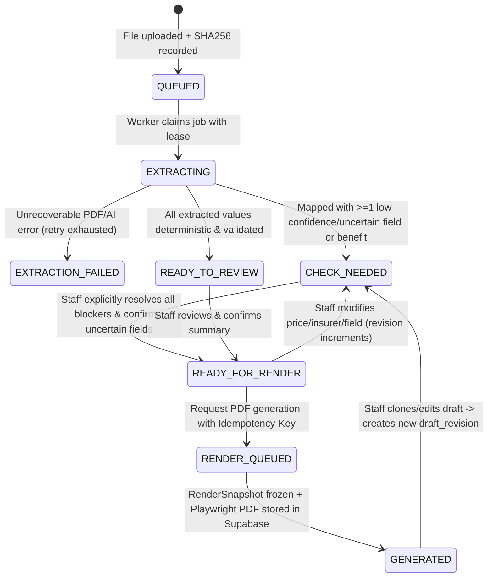
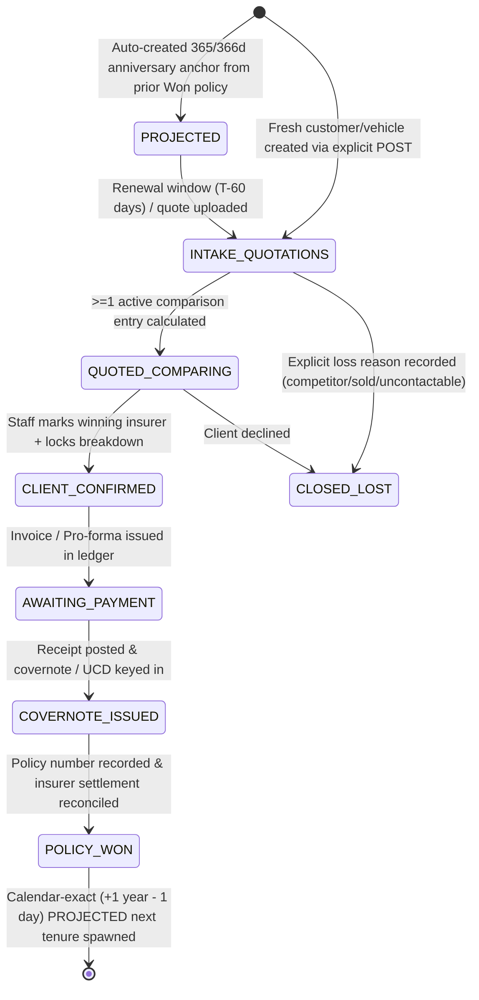

# Use Cases, System Design, Actors, Lifecycles, State Machines & Business Invariants

> **Textbook Purpose**: A first-year software engineer should be able to read this document and know *who* uses Risklocker, *every allowed transition* a quotation/vehicle/payment can take, and *what bad transitions the system must physically prevent*.

---

## 1. Core Actors & Authorization Boundaries (Least Privilege)

Current code checks roles inconsistently: [`backend/app/auth/rbac.py`](file:///c:/Users/mahmud/Desktop/Code/risklocker/quote_risklocker/backend/app/auth/rbac.py#L13-L36) defines `ADMIN_ROLES`, `PRIVILEGED_ROLES` (which confusingly includes `Role.DEV` alongside `ADMIN`), and `BUSINESS_ROLES`, while some routes omit `require_role()` completely ([`system.py:823-826`](file:///c:/Users/mahmud/Desktop/Code/risklocker/quote_risklocker/backend/app/api/routers/system.py#L823-L826)). In an enterprise SaaS, every actor has an explicit boundary:

| Actor Role | Business Responsibilities | Strictly Allowed Mutations | Strictly Forbidden Actions |
| :--- | :--- | :--- | :--- |
| **Staff / Advisor (`staff`)** | Upload insurer PDFs, verify uncertain OCR/AI fields, toggle customer add-ons, compare quotes, mark Won/Lost, record payment proof. | Draft fields on assigned/team sessions; benefit selections; comparison overrides; manual comparison entries; ledger stage progression. | Editing JPJ road-tax schedules, default runner fee, global benefit catalogs, AI prompts, published templates, or user roles. |
| **Agency Admin (`admin`)** | Manage insurer configurations, benefit packages/rules, brand assets (QR/logos), team users, PICs, approve published catalogs & templates. | Publish/retire catalog revisions & template revisions; configure bank/payment profiles; adjust runner fee defaults; manage non-super-admin accounts. | Deleting or mutating already-issued `RenderSnapshot`, `GeneratedPdfVersion`, or finalized `JournalEntry` rows. |
| **Super Admin (`super_admin`)** | Cross-organization billing/audit, `Admin` promotion/demotion, system security & key rotation. | Everything `admin` can do + security key rotation & compliance exports. | Direct raw database bypass of ledger double-entry or audit trails. |
| **Engineering Support (`dev`)** | Inspect worker health, AI token telemetry, schema checks, read-only diagnostics. | Diagnostics, non-PII system checks (**must NOT** automatically carry business financial write powers in production). | Quietly editing customer quotations or agency financial settings in production. |
| **End Customer (`external_link`, future)** | Read-only tokenized viewer for issued Design 2 quotation PDF / renewal summary & payment upload. | Acknowledge quote or select optional add-ons via signed single-purpose token. | Any API access outside scoped public quotation token. |

---

## 2. End-to-End Business Journeys & Current Failure Points

### Journey A: Single Quotation (`Upload -> Extract -> Review -> Preview -> Generate PDF`)
1. **Upload**: Staff uploads an insurer PDF (`backend/app/api/routers/sessions.py`, [`upload_intake_service.py`](file:///c:/Users/mahmud/Desktop/Code/risklocker/quote_risklocker/backend/app/services/upload_intake_service.py)).
2. **Background Extraction**: Worker reads PDF natively (`native_pdf.py`), falls back to OCR (`ocr.py`), invokes Gemini (`gemini_extractor.py`), and maps fields/benefits (`draft_mapper.py`).
   - *Where it breaks today*: [`draft_mapper.py:312-319`](file:///c:/Users/mahmud/Desktop/Code/risklocker/quote_risklocker/backend/app/extraction/draft_mapper.py#L312-L319) forces `valuation_type` to `"ready"` even when guessing `"Market Value"`; [`:385-425`](file:///c:/Users/mahmud/Desktop/Code/risklocker/quote_risklocker/backend/app/extraction/draft_mapper.py#L385-L425) computes EV road tax using stale `resolved_vtype`; [`:556-558`](file:///c:/Users/mahmud/Desktop/Code/risklocker/quote_risklocker/backend/app/extraction/draft_mapper.py#L556-L558) overwrites the Risklocker total with whatever total the insurer PDF had.
3. **Human Review (`ReviewPhase`)**: Staff confirms or corrects uncertain fields, chooses optional add-ons, checks live preview.
   - *Where it breaks today*:
     - [`review-phase.tsx:207`](file:///c:/Users/mahmud/Desktop/Code/risklocker/quote_risklocker/frontend/src/components/session-workspace/review-phase.tsx#L207) formats arbitrary text fields (NRIC, notes) through `formatCoverPeriod()`, scrambling hyphenated strings into inverted date-like chunks!
     - [`review-phase.tsx:1392-1402`](file:///c:/Users/mahmud/Desktop/Code/risklocker/quote_risklocker/frontend/src/components/session-workspace/review-phase.tsx#L1392-L1402) mutates React state (`formValues["vehicle_type"] = ...`) inside `useMemo`.
     - [`workspace_common.py:241-250`](file:///c:/Users/mahmud/Desktop/Code/risklocker/quote_risklocker/backend/app/services/workspace_common.py#L241-L250) marks unconfirmed fields `scalar_check_needed`, which keeps UI status stuck on **Check Needed** even after automatic mapping, while [`generation_service.py:494`](file:///c:/Users/mahmud/Desktop/Code/risklocker/quote_risklocker/backend/app/services/generation_service.py#L494) ignores `scalar_check_needed` completely!
4. **Render & Archive (`PreviewPhase` / PDF Download)**:
   - *Where it breaks today*: Clicking **Download PDF** in Review (`review-phase.tsx:2137-2188`) takes a 4x PNG screenshot using `jsPDF` (zero selectable text, diverges from server Playwright PDF) and fires off background archiving after download. Meanwhile the backend embedded worker passes `storage=None` ([`main.py:82`](file:///c:/Users/mahmud/Desktop/Code/risklocker/quote_risklocker/backend/app/main.py#L82)) -> [`render_worker.py:195-217`](file:///c:/Users/mahmud/Desktop/Code/risklocker/quote_risklocker/backend/app/workers/render_worker.py#L195-L217) saves every PDF to ephemeral `.qc-tmp/stateless_generated/` instead of Supabase!

### Journey B: Multi-Quote Marketing Comparison & Winner Selection
1. Staff opens `/upload/marketing-comparison` or navigates to `/comparison?tenure_id=...`.
2. System creates or loads one `InsuranceTenure` (representing one vehicle's annual policy period) and links multiple `Session` uploads -> `TenureComparisonEntry` columns.
   - *Where it breaks today*:
     - Opening `/comparison` without `?tenure_id=` triggers an automatic `POST /tenures` on React mount (`comparison/page.tsx:20-31`) creating garbage `vehicle_no="UNPLATED"` records and risking `UNIQUE` constraint collisions ([`tables.py:415`](file:///c:/Users/mahmud/Desktop/Code/risklocker/quote_risklocker/backend/app/models/tables.py#L415)).
     - Calling `GET /api/comparison/{tenure_id}` executes [`get_marketing_comparison()`](file:///c:/Users/mahmud/Desktop/Code/risklocker/quote_risklocker/backend/app/services/marketing_comparison_service.py#L770-L910), which **mutates** `customer`, `tenure`, `tracked_vehicle`, and `entries` and commits inside an HTTP `GET`!
     - [`towing_evaluator.py:231`](file:///c:/Users/mahmud/Desktop/Code/risklocker/quote_risklocker/backend/app/services/marketing_comparison/towing_evaluator.py#L231) tests `"4" in text` -> any STMB PA Plus PDF containing digit `4` (like year `2024`, plate `VAB400`, or `RM 400`) is falsely promoted to `"Unlimited"` towing!

### Journey C: Motor Renewal Lifecycle & Yearly Rollover (`12 Stages -> Win -> Projected Next Tenure`)
1. When a tenure reaches Won (`Close - Win`, `Issue Policy`, covernote linked, or policy number assigned), `project_next_year_tenure` creates the next year's projected renewal locker (`insurance_tenure_service.py:675-710`).
   - *Where it breaks today*: `end_date = start_date + timedelta(days=364)` ([`:126,131,694`](file:///c:/Users/mahmud/Desktop/Code/risklocker/quote_risklocker/backend/app/services/insurance_tenure_service.py#L126)) loses 1 day on every leap year (`2024-02-29`, `2028-02-29`), drifting renewal anniversary dates permanently! And payment collection is tracked solely via two booleans (`client_payment_received`, `agency_payment_done` at [`tables.py:339-340`](file:///c:/Users/mahmud/Desktop/Code/risklocker/quote_risklocker/backend/app/models/tables.py#L339-L340)), with zero invoice/receipt/journal trail.

---

## 3. Target Enterprise Finite-State Machines (FSMs)

A senior engineer defines **legal states and guards** before writing code. Notice how cleanly these four state machines prevent every silent failure we found:

### 3.1 Quotation Extraction & Review State Machine

**Hard State Guard Invariants**:
1. A transition to `READY_FOR_RENDER` is rejected unless **every** blocker (both critical fields like `customer_name`, `vehicle_no`, `premium`, `total_amount` AND uncertain benefit costs) is resolved or explicitly acknowledged. Never bypass `scalar_check_needed` silently (`generation_service.py:494`)!
2. Once a `RenderSnapshot` and `GeneratedPdfVersion` exist for `(draft_id, draft_revision)`, **neither the draft revision, its snapshot, nor its PDF file may ever be mutated or cascade-deleted**.

### 3.2 Motor Tenure Lifecycle & Renewal Chain State Machine

---

## 4. Non-Negotiable System Invariants (Text-Book Checklist)

These rules must hold true across every module in Phase 1–5:

1. **HTTP Method Purity**: `GET` endpoints MUST be 100% side-effect free (read-only). Opening a comparison matrix or workspace must NEVER create records, merge customers, or update vehicle plates ([`comparison.py:124`](file:///c:/Users/mahmud/Desktop/Code/risklocker/quote_risklocker/backend/app/api/routers/comparison.py#L124), [`comparison/page.tsx:19`](file:///c:/Users/mahmud/Desktop/Code/risklocker/quote_risklocker/frontend/src/app/comparison/page.tsx#L19)).
2. **Single Source of Truth for Math & Formatting**: Road tax, add-on eligibility, benefit sorting, and `total_payable` are computed **once** on the backend in `Decimal` (`ROUND_HALF_UP`). The frontend may optimistically mirror only via read-only formatting—never an out-of-sync hardcoded `880` vs `840` rate table!
3. **Zero Silent PII / Demo Fallbacks in Renderers**: A production renderer or builder preview must NEVER substitute hardcoded customer/plate/bank values (`"CHENG TECK KIOING"`, `"ANY 368"`, `"RL260000314"`, account `12300318500`) when a field is empty. Empty fields render `"—"` (or clear missing-data badge in draft mode; blocked in final generation).
4. **No Silent Guessing of Extracted Values**: In line with `docs/domain/BUSINESS-RULES.md`, uncertain AI/regex inferences (e.g., assuming `"Market Value"` when Endorsement 89 status is unknown, or promoting `"4"` to `"Unlimited"` towing) MUST remain `check_needed` / `"Unknown"` until verified.
5. **Immutable Published & Financial Records**: Published benefit catalogs, published template revisions, `RenderSnapshot`, `GeneratedPdfVersion`, and accounting `JournalEntry` rows are append-only/immutable at the database trigger layer.
6. **True Durable Persistence**: Production PDFs live exclusively in private Supabase Storage with SHA-256 verification; ephemeral disk `.qc-tmp/` is used strictly as a short-lived scratch pad during Playwright execution and immediately cleaned.
7. **Malaysian Calendar-Exact Tenure Arithmetic**: Anniversary periods use exact calendar arithmetic (`add_one_policy_year(start)` = `(start + relativedelta(years=1)) - timedelta(days=1)`), never fixed `364`-day offsets.

---

## 5. Edge Cases Matrix (Malaysia Motor Insurance Domain)

| Edge Case | Current Code Behavior | Required Enterprise Behavior |
| :--- | :--- | :--- |
| **Vehicle >2500cc (`2501cc`–`3000cc` West MY)** | Tax **drops** from `RM 880.00` (at 2500cc) to `RM 842.50` (at 2501cc) in backend (`road_tax_engine.py:42`), while frontend `provider.tsx:116` uses `880`. | Unified JPJ rate verified (`880.00` base + `2.50/cc` in `>2500cc` West MY; Labuan `440.00` base + `1.25/cc`) in **one** DB-seeded/AST-safe backend table; frontend fetches preview calculation via API. |
| **EV vs ICE Vehicle Classification** | `draft_mapper.py:385-425` updates `fields["vehicle_type"]` to EV **after** copying `resolved_vtype`, calculating road tax as ICE! | Normalize powertrain (`ICE` vs `EV` + Watts/kW vs CC) **first** before looking up vehicle class and road tax schedule. |
| **Unplated / Brand-New Showroom Vehicles** | `comparison/page.tsx` & `vehicle_tracking_service.py:214` assign `"UNPLATED"` onto `TrackedVehicle.vehicle_no` (`unique=True`), crashing the 2nd unplated car! | `TrackedVehicle.plate_no` nullable + partial unique index `WHERE plate_no IS NOT NULL`; provisional identity keyed by `chassis_no` or system sequence (`PROV-...`) and `is_provisional=true`. |
| **Same-Name Customers Without NRIC** | `customer_account_service.py:51-54` merges any customer with matching `canonical_name`, conflating homonyms (e.g., two `"TAN AH KOW"`s). | Never auto-merge solely on `canonical_name` when `id_number` is absent! Require exact normalized NRIC/BRN (`id_number`) match, or flag as potential duplicate for manual link confirmation. |
| **Same Insurer Uploaded Twice for Renewal (v1 vs v2)** | `marketing_comparison_service` can hold overlapping/stale quote rows without explicit supersession tracking. | Support versioned quote revisions per `(tenure_id, company_id)` so staff can compare revision `v1` vs `v2` cleanly with only the latest marked active in ranking. |
| **NRIC & Reference Formatting** | `displayValue()` in `review-phase.tsx:207` passes `"text"` fields to `formatCoverPeriod()`, scrambling `"900101-14-5678"` pattern matches. | Keep formatting strictly per `FieldKind`; `"text"` renders verbatim; `"date"` and `"cover_period"` only format fields explicitly typed as dates/periods. |

