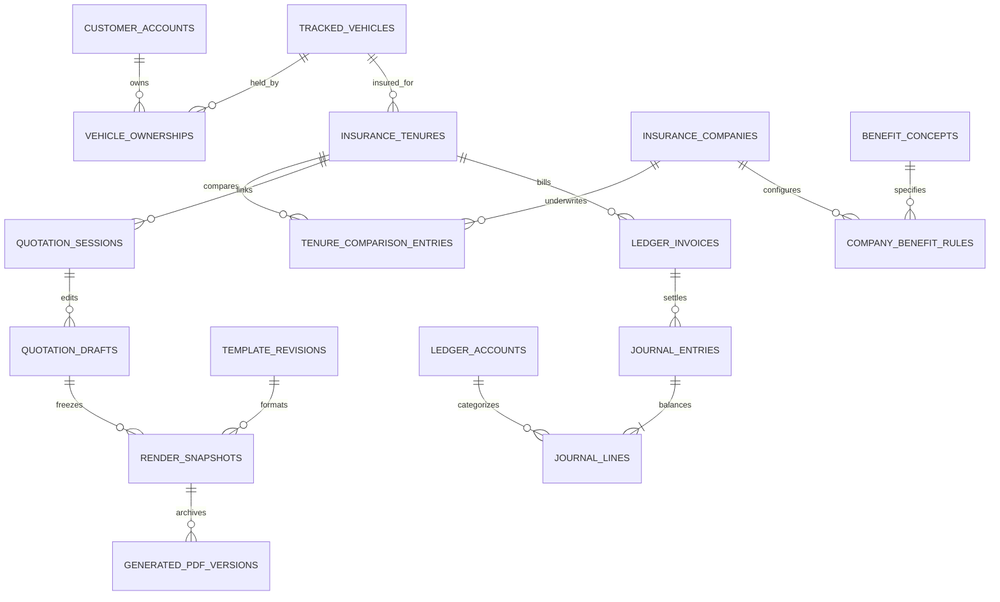

# Enterprise Database Architecture, Normalized Schema, ERD & Migration Blueprint

> **Textbook Purpose**: If databases are brand new to you, think of a database schema as the **steel skeleton** of a skyscraper. Even if the paint (React UI) looks great, if columns allow `"RM 1,000"` as plain text instead of exact numbers, or if deletion cascades erase legal receipts, the building eventually collapses. Here is every structural flaw in Risklocker's current 74 migrations and the exact normalized PostgreSQL design to replace it.

---

## 1. Forensic Diagnosis of Current Database Schema (`tables.py` & `migrations/001`–`074`)

### 1.1 Dropped Immutability Triggers & Destructive Cascades (`migrations/056`, `061`)
- **What exists now**: [`migrations/056_drop_catalog_immutability_triggers.sql`](file:///c:/Users/mahmud/Desktop/Code/risklocker/quote_risklocker/migrations/056_drop_catalog_immutability_triggers.sql) dropped all triggers preventing edits to published `benefit_catalog_revisions`, `catalog_offerings`, `benefit_relations`, and `benefit_packages`. Worse, [`migrations/061_drop_template_revision_immutability_triggers.sql`](file:///c:/Users/mahmud/Desktop/Code/risklocker/quote_risklocker/migrations/061_drop_template_revision_immutability_triggers.sql) dropped `template_revision_immutable` AND altered `render_snapshots.template_revision_id` from `ON DELETE RESTRICT` to `ON DELETE CASCADE` (contradicting [`tables.py:1254`](file:///c:/Users/mahmud/Desktop/Code/risklocker/quote_risklocker/backend/app/models/tables.py#L1254), which still claims `ondelete="RESTRICT"`!).
- **Why this is dangerous**: Deleting or editing a template retroactively corrupts or destroys historical `RenderSnapshot` audit proof of what was quoted to a client 6 months ago. SQLAlchemy's model (`tables.py`) and actual PostgreSQL DDL (`061`) have drifted out of sync!

### 1.2 "Money as Strings" and "Money as IEEE Floats" (`tables.py:310-340, 377-389, 508-526`)
- **Why floats fail**: Binary floating-point (`0.1 + 0.2 = 0.30000000000000004`) causes 1-sen rounding drift on SST (8%), stamp duty (RM 10), NCD deductions, and reconciliation.
- **Current bugs**:
  - `InsuranceTenure` (`tables.py:310-317`) and `TenureComparisonEntry` (`tables.py:377-389`) store `Numeric(12, 2)` in Postgres, **but** map them as Python `Mapped[float]` in SQLAlchemy instead of `Decimal`.
  - `ClientRecord` (`tables.py:508-526`) stores **14 monetary fields** (`coverage_amount`, `premium`, `roadtax`, `service_fee`, `total_premium`, `market_value`, `agreed_value`, `excess_amount`, `basic_premium`, `ncd_amount`, `service_tax`, `stamp_duty`, `gross_premium`) as `String(100)`! You cannot `SUM()`, index, or audit `String(100)` reliably in SQL.

### 1.3 Benefit System Sprawl: `4 + 1` Competing Representations
Because features were stacked without consolidating old tables, the DB currently holds **4 overlapping benefit systems** plus a 5th hardcoded one:
1. `OurSpecial` / `OurSpecialVariant` ([`tables.py:140`](file:///c:/Users/mahmud/Desktop/Code/risklocker/quote_risklocker/backend/app/models/tables.py#L140), migration `013`).
2. `BenefitConcept` / `BenefitCatalog` / `CatalogOffering` / `BenefitPackage` (`024`, `033`).
3. `BenefitProfile` (`CompanyBenefitProfile`) / `CompanyBenefitConfig` / `CompanyBenefitCondition` ([`tables.py:1261-1326`](file:///c:/Users/mahmud/Desktop/Code/risklocker/quote_risklocker/backend/app/models/tables.py#L1261-L1326), `044`, `045`).
4. `GlobalBenefitProfile` / `GlobalBenefitProfileAsset` ([`tables.py:1329-1365`](file:///c:/Users/mahmud/Desktop/Code/risklocker/quote_risklocker/backend/app/models/tables.py#L1329-L1365), `047`) + `BenefitCardPreset` ([`tables.py:1368`](file:///c:/Users/mahmud/Desktop/Code/risklocker/quote_risklocker/backend/app/models/tables.py#L1368), `048`).
5. *The "+1" Hardcoded Shadow*: `CANONICAL_24_CATALOG` copied manually between [`unified_addon_engine.py:14-183`](file:///c:/Users/mahmud/Desktop/Code/risklocker/quote_risklocker/backend/app/rendering/unified_addon_engine.py#L14-L183) and [`unified-addon-engine.ts:29-204`](file:///c:/Users/mahmud/Desktop/Code/risklocker/quote_risklocker/frontend/src/lib/unified-addon-engine.ts#L29-L204), PLUS `BENEFIT_CATALOGS` in [`benefit_catalog_matrix.py:7-100`](file:///c:/Users/mahmud/Desktop/Code/risklocker/quote_risklocker/backend/app/services/benefit_catalog_matrix.py#L7-L100).

### 1.4 Broken Constraints on Identity & Finance
- `TrackedVehicle.vehicle_no` is `nullable=False, unique=True` ([`tables.py:415`](file:///c:/Users/mahmud/Desktop/Code/risklocker/quote_risklocker/backend/app/models/tables.py#L415)). Assigning `"UNPLATED"` to unplated cars guarantees `IntegrityError` on the second unplated quote!
- `InsuranceTenure` tracks money using two booleans: `client_payment_received` and `agency_payment_done` ([`tables.py:339-340`](file:///c:/Users/mahmud/Desktop/Code/risklocker/quote_risklocker/backend/app/models/tables.py#L339-L340)). That cannot represent partial payments, deposits, refunds, credit notes, sub-agent commissions, insurer remittance batches, or mismatched RM amounts.
- Missing schema alignment on `InsuranceCompany`: code reads `company.company_key` ([`generation_service.py:351`](file:///c:/Users/mahmud/Desktop/Code/risklocker/quote_risklocker/backend/app/services/generation_service.py#L351)), which doesn't exist — only `slug` exists ([`tables.py:104`](file:///c:/Users/mahmud/Desktop/Code/risklocker/quote_risklocker/backend/app/models/tables.py#L104)).

---

## 2. Target Normalized Enterprise ERD



---

## 3. Target Normalized PostgreSQL Table Specifications (`Migrations 075+`)

### 3.1 Multi-Tenant Organization & Agency Bank Configuration (Eliminating Hardcoded PII)
Currently, RISKLOCKER bank details (`Hong Leong Bank`, `12300318500`) and DuitNow QR images are hardcoded in Python and TSX. Move them into a proper table:

| Table | Key Columns & Types | Constraints / Indexes |
| :--- | :--- | :--- |
| `agency_profiles` | `id UUID PK`, `legal_name TEXT NOT NULL`, `reg_no TEXT`, `bank_name TEXT NOT NULL`, `bank_account_no TEXT NOT NULL`, `bank_holder_name TEXT NOT NULL`, `duitnow_qr_asset_id UUID FK -> business_assets(id)`, `whatsapp_qr_asset_id UUID FK -> business_assets(id)`, `logo_asset_id UUID FK -> business_assets(id)`, `is_default BOOLEAN NOT NULL DEFAULT false`, `updated_at TIMESTAMPTZ` | Partial unique index `uq_default_agency_profile ON agency_profiles(is_default) WHERE is_default = true`. Prevents hardcoded bank PII in renderers. |

### 3.2 Normalized Vehicle & Customer Identity (Fixing Unplated Collisions & Same-Name Merges)

```sql
-- Partial unique index design for tracked_vehicles (Migration 075+)
ALTER TABLE public.tracked_vehicles
    ADD COLUMN IF NOT EXISTS is_provisional BOOLEAN NOT NULL DEFAULT false,
    ALTER COLUMN vehicle_no DROP NOT NULL;

-- Drop unsafe global unique constraint that rejects multiple unplated/provisional vehicles
ALTER TABLE public.tracked_vehicles DROP CONSTRAINT IF EXISTS tracked_vehicles_vehicle_no_key;

-- Enforce uniqueness ONLY on real plates (normalized uppercase no-space), chassis, engine
CREATE UNIQUE INDEX uq_tracked_vehicles_real_plate
    ON public.tracked_vehicles (UPPER(REPLACE(vehicle_no, ' ', '')))
    WHERE vehicle_no IS NOT NULL
      AND vehicle_no NOT IN ('UNPLATED', 'UNKNOWN', 'NEW', 'NONE', 'NA', 'N/A');

CREATE UNIQUE INDEX uq_tracked_vehicles_chassis
    ON public.tracked_vehicles (UPPER(TRIM(chassis_no)))
    WHERE chassis_no IS NOT NULL AND TRIM(chassis_no) <> '';
```

- **Customer Identity Rule**: `customer_accounts(id_number)` already uniquely indexes government IDs (`NRIC`/`SSM BRN`/`Passport`), while provisional records use `id_number_verified BOOLEAN NOT NULL DEFAULT false`. Secondary lookup by `canonical_name` is converted from "silent auto-merge" to a `customer_duplicate_candidates` suggestion table until staff confirms NRIC.

### 3.3 Unified Single-Source Benefit & Package Engine (Replacing `4 + 1` Systems)
Consolidate all benefit definitions into **3 normalized core tables** + **1 immutable snapshot table**:
1. **`benefit_concepts`** *(Global Canonical Catalog — replaces `OurSpecial`, Python `CANONICAL_24_CATALOG`, TS `CANONICAL_24_CATALOG`, and `benefit_catalog_matrix.py`)*:
   - `id UUID PK`, `concept_key VARCHAR(80) UNIQUE NOT NULL` (e.g. `windscreen`, `towing`, `special_perils`), `display_order INT NOT NULL`, `title VARCHAR(160) NOT NULL`, `default_description TEXT NOT NULL`, `icon_key VARCHAR(80) NOT NULL`, `icon_asset_id UUID NULL FK -> business_assets(id) ON DELETE RESTRICT`, `category_scope VARCHAR(40)` (`private_car`, `ev`, `motorcycle`, `commercial`), `is_core_design2_slot BOOLEAN NOT NULL DEFAULT false`.
2. **`company_benefit_rules`** *(Versioned under `benefit_catalog_revisions` — unifies `CatalogOffering`, `BenefitPackagePlanItem`, `CompanyBenefitConfig`, `CompanyBenefitCondition`)*:
   - `id UUID PK`, `catalog_revision_id UUID NOT NULL FK`, `company_id UUID NOT NULL FK -> insurance_companies(id) ON DELETE RESTRICT`, `package_id UUID NULL FK`, `concept_id UUID NOT NULL FK -> benefit_concepts(id) ON DELETE RESTRICT`, `inclusion_kind VARCHAR(30) NOT NULL CHECK (inclusion_kind IN ('included_foc', 'optional_addon', 'excluded', 'conditional_upgrade'))`, `coverage_formula TEXT`, `cost_formula TEXT`, `condition_expr JSONB NULL` (e.g. replaces `CompanyBenefitCondition`), `description_override TEXT`.
   - `UNIQUE (catalog_revision_id, company_id, COALESCE(package_id, '00000000-0000-0000-0000-000000000000'::uuid), concept_id)`.
3. **`draft_benefit_selections`** *(Explicit user/extraction decisions with `NUMERIC(12,2)` price)*:
   - `id UUID PK`, `draft_id UUID NOT NULL FK -> quotation_drafts(id) ON DELETE CASCADE`, `concept_id UUID NOT NULL FK`, `selection_state VARCHAR(30) NOT NULL CHECK (...)`, `cost_status VARCHAR(20) NOT NULL CHECK (...)`, `coverage_amount NUMERIC(12,2) NULL`, `premium_amount NUMERIC(12,2) NULL`, `origin VARCHAR(20) CHECK (origin IN ('extracted', 'catalog_rule', 'manual'))`, `is_verified BOOLEAN NOT NULL DEFAULT false`.
4. **`render_snapshots`** *(Immutable frozen context)*: restores `ON DELETE RESTRICT` to `template_revisions` and `benefit_catalog_revisions`. Published revisions are soft-archived (`archived_at`) instead of hard-deleted so historical audit links NEVER break.

### 3.4 Enterprise Double-Entry Financial Ledger (Replacing Booleans & `String(100)`)
Detailed domain audit lives in [`09-domain-modules/ledger-and-accounting`](file:///c:/Users/mahmud/Desktop/Code/risklocker/quote_risklocker/docs/change/09-domain-modules/ledger-and-accounting/), while the core relational schema belongs here:

| Table | Purpose & Immutable Invariants | Columns |
| :--- | :--- | :--- |
| **`ledger_accounts`** | Chart of Accounts (`Asset`, `Liability`, `Revenue`, `Expense`) | `id UUID PK`, `code VARCHAR(20) UNIQUE NOT NULL` (`1010-BANK-HLB`, `1200-AR-CLIENT`, `2100-AP-INSURER`, `4010-COMM-REV`, `4020-RUNNER-FEE`), `name TEXT`, `account_type VARCHAR(20) CHECK (...)`, `normal_side VARCHAR(6) CHECK (normal_side IN ('debit','credit'))`. |
| **`ledger_invoices`** | Customer billable obligations per won tenure | `id UUID PK`, `tenure_id UUID NOT NULL FK -> insurance_tenures(id) ON DELETE RESTRICT`, `invoice_no VARCHAR(40) UNIQUE NOT NULL`, `gross_premium NUMERIC(12,2) NOT NULL`, `service_tax NUMERIC(12,2) NOT NULL`, `stamp_duty NUMERIC(12,2) NOT NULL`, `road_tax NUMERIC(12,2) NOT NULL`, `runner_fee NUMERIC(12,2) NOT NULL`, `discount NUMERIC(12,2) NOT NULL DEFAULT 0.00`, `total_receivable NUMERIC(12,2) NOT NULL`, `status VARCHAR(24)` (`draft`, `issued`, `partially_paid`, `paid`, `void`), `issued_at TIMESTAMPTZ`. |
| **`journal_entries`** | Append-only accounting headers (reversals create new entries, never `UPDATE`/`DELETE`) | `id UUID PK`, `entry_no VARCHAR(40) UNIQUE NOT NULL`, `tenure_id UUID NULL FK`, `invoice_id UUID NULL FK`, `entry_date DATE NOT NULL`, `description TEXT NOT NULL`, `idempotency_key VARCHAR(120) UNIQUE NOT NULL`, `reverses_entry_id UUID NULL FK -> journal_entries(id)`, `created_by UUID FK -> users(id)`, `created_at TIMESTAMPTZ NOT NULL`. |
| **`journal_lines`** | Balanced debit/credit postings (`NUMERIC(12,2)`) | `id UUID PK`, `journal_entry_id UUID NOT NULL FK -> journal_entries(id) ON DELETE RESTRICT`, `account_id UUID NOT NULL FK -> ledger_accounts(id) ON DELETE RESTRICT`, `debit_amount NUMERIC(12,2) NOT NULL DEFAULT 0.00 CHECK (debit_amount >= 0)`, `credit_amount NUMERIC(12,2) NOT NULL DEFAULT 0.00 CHECK (credit_amount >= 0)`, `CHECK ((debit_amount > 0 AND credit_amount = 0) OR (credit_amount > 0 AND debit_amount = 0))`. |

**Database Enforcement Trigger (`DEFERRED CONSTRAINT TRIGGER`)**: At commit time, for every `journal_entry_id`, `SUM(debit_amount) = SUM(credit_amount)` AND `SUM(debit_amount) > 0`. It becomes mathematically impossible for Postgres to store an unbalanced ledger transaction!

---

## 4. Restored Immutability Triggers & Composite Index Checklist

### 4.1 Restoring Triggers Removed by Migrations `056` and `061`
Instead of dropping triggers to let admins edit typos in published templates or delete unused drafts, use a clean **Lifecycle Split**:
1. Add `archived_at TIMESTAMPTZ NULL` to `template_revisions` and `benefit_catalog_revisions`.
2. Re-attach `BEFORE UPDATE OR DELETE` immutability triggers that allow changing **only** `archived_at` (and `is_active = false`), while **blocking** any mutation to `config`, `offerings`, or hard `DELETE` whenever state is `published` or referenced by `render_snapshots`.
3. Re-attach `ON DELETE RESTRICT` on `render_snapshots.template_revision_id` and `render_snapshots.catalog_revision_id`.

### 4.2 Essential Composite Performance Indexes (Fixing `_rows()` Table Scans)

| Table | Missing / Required Index | Fixes Query Pattern |
| :--- | :--- | :--- |
| `jobs` | `CREATE UNIQUE INDEX uq_jobs_idempotency_render ON jobs(job_type, idempotency_key) WHERE idempotency_key IS NOT NULL;` | Eliminates `generation_service.py:94` full-table `_rows(db, Job)` scan! |
| `jobs` | `CREATE INDEX ix_jobs_queue_claim ON jobs(state, priority DESC, available_at ASC) WHERE state = 'queued';` | Makes worker polling partial-index O(log n) instead of full scan. |
| `insurance_tenures` | `CREATE INDEX ix_tenures_active_expiry ON insurance_tenures(expiry_month, stage) WHERE deleted_at IS NULL AND is_discarded = false;` | Powers `/ledger` monthly inbox in <5ms. |
| `client_records` | Cast monetary columns to `NUMERIC(12,2)` (via safe dual-write backfill columns `*_num`) + index `vehicle_no`, `created_at DESC`. | Enables fast SQL aggregations for `/insights` instead of Python parsing of `String(100)`. |

---

## 5. Safe Multi-Step Migration Rollout (`075`–`081`)

| Migration | Action & Safety Guarantee (Expand -> Backfill -> Contract) |
| :--- | :--- |
| `075_agency_profile_and_company_slug_fix.sql` | Create `agency_profiles`, seed default bank/QR asset links (zero secrets hardcoded in git — loaded via env/setup script), normalize `insurance_companies.slug` `NOT NULL`. |
| `076_tracked_vehicle_partial_unique_and_identity.sql` | Nullable `vehicle_no` for provisional quotes, drop `UNPLATED` collision constraint, add partial unique indexes on normalized plate/chassis/engine. |
| `077_restore_immutability_and_restrict_cascades.sql` | Change `render_snapshots` FKs back to `ON DELETE RESTRICT`; add `archived_at`; reinstall PostgreSQL immutability triggers (`template_revisions`, `benefit_catalog_revisions`). |
| `078_numeric_monetary_columns_backfill.sql` | Add `NUMERIC(12,2)` columns on `client_records` alongside legacy string columns, backfill cleanly using regex-validated SQL conversion, verify checksum parity. |
| `079_unified_benefit_catalog_schema.sql` | Normalize `OurSpecial`, `BenefitProfile`, `GlobalBenefitProfile`, and `CANONICAL_24_CATALOG` rows into `benefit_concepts` + `company_benefit_rules` with dual-read views during transition. |
| `080_double_entry_financial_ledger.sql` | Create `ledger_accounts`, `ledger_invoices`, `journal_entries`, `journal_lines`, plus `CONSTRAINT TRIGGER` enforcing `SUM(debits) = SUM(credits)`. |
| `081_composite_indexes_and_worker_locks.sql` | Add unique partial index on `jobs(job_type, idempotency_key)` and composite queue/tenure indexes `CONCURRENTLY`. |

