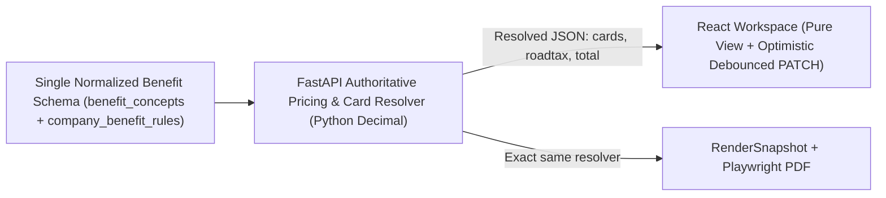

# Architecture Variants Tournament: Rendering, State, Pricing & API Trade-Offs

> **Textbook Purpose**: Great engineers don't jump at the first working hack — they compare 3 concrete architectural variants side-by-side across **Modularity**, **Zero Hardcoding**, **Data Consistency**, and **Production Scalability**, then pick a clear winner with zero regrets.

---

## 1. Tournament #1: Live Preview vs. Official PDF Generation Pipeline

### Current Broken Reality
Right now Risklocker runs **four disconnected visual engines**:
1. [`template_renderer.py`](file:///c:/Users/mahmud/Desktop/Code/risklocker/quote_risklocker/backend/app/rendering/template_renderer.py) — Custom canvas HTML renderer for Design 1 templates (with hardcoded `RL260000341` fallback at `:782-787`).
2. [`template_renderer_design2.py`](file:///c:/Users/mahmud/Desktop/Code/risklocker/quote_risklocker/backend/app/rendering/template_renderer_design2.py) — Dedicated HTML string generator for Design 2 (with hardcoded `CHENG TECK KIOING` and bank details `12300318500` at `:114-130, 446-448`).
3. [`design2-canvas.tsx`](file:///c:/Users/mahmud/Desktop/Code/risklocker/quote_risklocker/frontend/src/components/template-canvas/design2-canvas.tsx) + [`shared.tsx`](file:///c:/Users/mahmud/Desktop/Code/risklocker/quote_risklocker/frontend/src/components/template-canvas/shared.tsx) — React re-implementation duplicating Design 2 (`:267-321, 585-587`), while [`preview-phase.tsx:607-743`](file:///c:/Users/mahmud/Desktop/Code/risklocker/quote_risklocker/frontend/src/components/session-workspace/preview-phase.tsx#L607-L743) renders non-Design-2 templates via a completely fake static `<svg>`.
4. [`review-phase.tsx:2137-2180`](file:///c:/Users/mahmud/Desktop/Code/risklocker/quote_risklocker/frontend/src/components/session-workspace/review-phase.tsx#L2137-L2180) — Calls `toPng(..., { pixelRatio: 4 })` and embeds a huge raster screenshot inside `jsPDF`.

### Variant Comparison Matrix

| Criterion | Variant A: Keep React Canvas + `jsPDF` Screenshot | Variant B: Dual React + Python Synced Templates | Variant C: **Single Backend RenderSnapshot HTML + iframe Preview + Pooled Playwright PDF (Winner)** |
| :--- | :--- | :--- | :--- |
| **Visual 1:1 Parity** | Fails — browser font/OS variance & blurry raster PNG vs crisp vector backend PDF | Fragile — every Tailwind tweak must be ported manually between JSX and Python strings | **100% Guaranteed** — both the live preview iframe (`/api/sessions/{id}/preview-html` backed by `RenderSnapshot`) and Playwright PDF consume the **exact same HTML + inline SVG** output |
| **Selectable Vector Text** | No — `jsPDF` image has zero searchable/copyable text & 8–20 MB file size | Only on backend PDF | **Yes** — native Chromium vector PDF (`<300 KB`) |
| **Zero Hardcoding** | Leaks demo PII when canvas elements miss data | Doubles risk of hardcoded fallback drift | **Single `agency_profiles` + empty `"—"` contract** |
| **Interactive Speed** | Fast locally, crashes on mobile RAM at `pixelRatio: 4` | Fast UI typing, laggy drift on save | Fast debounce (`~180ms`) or client draft form + instant backend HTML fragment refresh |

**Decision**: Adopt **Variant C**. Delete the fake static `<svg>` fallback (`preview-phase.tsx:607-743`) and delete `jsPDF` `toPng` export (`review-phase.tsx:2144-2180`). Both **Download PDF** in Review and **Official Print** in Preview must stream the real backend Playwright PDF from Supabase Storage (or an immediate server render job with warm Chromium).

---

## 2. Tournament #2: Headless Chromium PDF Execution Strategy

### Current Broken Reality
[`pdf_generator.py:36-68`](file:///c:/Users/mahmud/Desktop/Code/risklocker/quote_risklocker/backend/app/rendering/pdf_generator.py#L36-L68) executes `with sync_playwright() as playwright: browser = playwright.chromium.launch(headless=True)` for **every single quotation PDF**. Spawning a cold Chromium process takes ~1.5–3.5 seconds and spikes ~350 MB RAM per concurrent worker slot (`WORKER_CONCURRENCY=10` in [`main.py:73`](file:///c:/Users/mahmud/Desktop/Code/risklocker/quote_risklocker/backend/app/main.py#L73) can spike **3.5 GB RAM** simultaneously and OOM-kill a 4 GB VPS!).

| Architecture Option | Cold Latency | Peak RAM (10 jobs) | Crash Isolation | Operational Complexity |
| :--- | :--- | :--- | :--- | :--- |
| **Option 1: Per-Job `chromium.launch()` (Current)** | ~2.5s | ~3.5 GB (OOM risk!) | High | Trivial |
| **Option 2: Pure Python ReportLab / WeasyPrint** | ~0.2s | ~150 MB | High | Reject — breaks modern CSS Grid/Flexbox & Chinese/Unicode glyph shaping (`公司银行戶口`) in Design 2 |
| **Option 3: Persistent Browser + Ephemeral `BrowserContext` Worker Pool (Winner)** | **~0.25s** | **~550 MB capped** (1 browser + `N=3` contexts, semaphore bounded) | High (each job gets fresh isolated incognito `BrowserContext` + auto-restart every 200 renders or crash) | Moderate (~120 lines well-tested pool manager) |

**Decision**: Implement **Option 3** (`ChromiumPool` managed by a dedicated worker process rather than 10 unbounded FastAPI threads). Enforce strict semaphore (`MAX_PDF_CONCURRENCY=3`) and automatic process recycling after 200 renders to eliminate memory leaks.

---

## 3. Tournament #3: Benefit Catalogs, Add-Ons & Pricing Engine (`4+1` Consolidation)

### Current Broken Reality
Benefit definitions are split across `OurSpecial` (`tables.py:140`), `CatalogOffering` (`tables.py`), `BenefitProfile`/`CompanyBenefitConfig` (`tables.py:1261-1303`), `GlobalBenefitProfile` (`:1329`), `benefit_catalog_matrix.py`, Python `CANONICAL_24_CATALOG`, and TypeScript `CANONICAL_24_CATALOG` ([`unified_addon_engine.py:14`](file:///c:/Users/mahmud/Desktop/Code/risklocker/quote_risklocker/backend/app/rendering/unified_addon_engine.py#L14) vs [`unified-addon-engine.ts:29`](file:///c:/Users/mahmud/Desktop/Code/risklocker/quote_risklocker/frontend/src/lib/unified-addon-engine.ts#L29)). Meanwhile pricing is recalculated independently in `draft_mapper.py`, `workspace_patch_service.py`, and frontend [`provider.tsx`](file:///c:/Users/mahmud/Desktop/Code/risklocker/quote_risklocker/frontend/src/components/session-workspace/provider.tsx) (which even disagrees with backend on `880` vs `840` road tax!).

| Variant | Code Duplication | Drift Risk | Network Overhead | Verdict |
| :--- | :--- | :--- | :--- | :--- |
| **Variant 1: Mirror Math in TS + Python (Current)** | Very High (2 road-tax engines, 2 addon engines, 3 pricers) | Extreme (already out of sync: `880` vs `840`) | Zero while typing | **REJECT** |
| **Variant 2: Shared WebAssembly (WASM) / JSON Rule DSL** | Low | Low | Zero while typing | Over-engineered for FastAPI + Next.js CRUD |
| **Variant 3: Server-Authoritative `Decimal` Calculator + Thin UI State (Winner)** | **Zero duplication** (delete TS road-tax/addon card builders) | **Zero mathematical drift** | Minimal (`PATCH /workspace` or `POST /calculate` debounced 250ms, <5ms SQL/Python execution) | **WINNER** |

---

## 4. Tournament #4: Comparison Sync Strategy (`GET` Mutation vs Explicit Command)

### Current Broken Reality
Opening `/comparison` fires `POST /tenures` on mount ([`comparison/page.tsx:24`](file:///c:/Users/mahmud/Desktop/Code/risklocker/quote_risklocker/frontend/src/app/comparison/page.tsx#L24)) with `"UNPLATED"`, and then `GET /api/comparison/{tenure_id}` executes [`get_marketing_comparison()`](file:///c:/Users/mahmud/Desktop/Code/risklocker/quote_risklocker/backend/app/services/marketing_comparison_service.py#L770-L910), which mutates `customer`, `tenure`, `tracked_vehicle`, and `entries` during a `GET` request!

| Variant | REST Compliance & Caching | Race Condition Safety | Debuggability |
| :--- | :--- | :--- | :--- |
| **Option A: Lazy Auto-Hydrate Inside `GET` (Current)** | Violates HTTP semantics; browser prefetch / React StrictMode triggers duplicate concurrent commits! | Broken (lost updates on two tabs refreshing) | Nightmare ("I only refreshed the page and my customer record changed!") |
| **Option B: Pure Read-Only `GET` + Idempotent Worker Hydration + Explicit `POST /reconcile` (Winner)** | **100% HTTP Safe** | Safe under React StrictMode & multiple tabs | Crystal clear audit trail (`Sync / Reconcile` runs on upload completion or button click) |

---

## 5. Tournament #5: Frontend State & Route Architecture

| Concern | Current Anti-Pattern | Target Winning Pattern |
| :--- | :--- | :--- |
| **Monolith Files** | `tenure-timeline-ledger.tsx` (`~4k`L), `builder/benefits/page.tsx` (`3,661L`), `review-phase.tsx` (`~3k`L), `comparison-matrix.tsx` (`2,003L`) | Feature-sliced modules (`features/workspace/`, `features/comparison/`, `features/ledger/`, `features/builder/`): each component `<250` lines with typed hooks |
| **State Mutations** | Mutating `formValues["vehicle_type"] = ...` inside `useMemo` ([`review-phase.tsx:1392-1402`](file:///c:/Users/mahmud/Desktop/Code/risklocker/quote_risklocker/frontend/src/components/session-workspace/review-phase.tsx#L1392-L1402)) | Pure derived selectors + `useReducer` store for draft patches |
| **Browser Persistence & Dialogs** | `localStorage` caching of benefit presets (`benefit-templates/page.tsx:265,438`) + `window.confirm/alert/prompt` (`review-header.tsx:69-85`) | Server state only (React Query / SWR pattern) + clean accessible `<ConfirmDialog>` & toast system |
| **Auth & Route Guards** | Partial `middleware.ts` matcher (`:32-43`) + CSS opacity nav links (`app-shell.tsx:232`) | Centralized protected matcher (`all routes except /login & /api/health`) + role-filtered navigation + backend RBAC as final gate |

