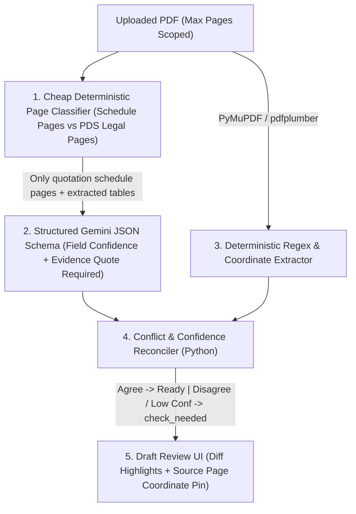

# Domain Module Audit: AI Extraction, Copilot Pipeline & Automation Engine

> **Module Scope**: Embedded AI document extraction (`orchestrator.py`, `gemini_extractor.py`, `gemini_account_service.py`, `candidate_finder.py`), RAG & Copilot assistant (`copilot.py`, `copilot_chat_service.py`, `grounding_assistant.py`, `catalog_operations_service.py`), prompt management (`settings/ai-engine`, `ai-context/page.tsx`), and floating UI (`global-ai-copilot.tsx`, `gemini-header-meter.tsx`, `gemini-quota-meter.tsx`).

---

## 1. Current AI Pipeline Forensics & Failure Points

### Issue AI-01 [P0]: Silent AI/Heuristic Fallbacks Bypass Human Verification
- **Where**: [`draft_mapper.py:312-319`](file:///c:/Users/mahmud/Desktop/Code/risklocker/quote_risklocker/backend/app/extraction/draft_mapper.py#L312-L319), [`orchestrator.py:85-104`](file:///c:/Users/mahmud/Desktop/Code/risklocker/quote_risklocker/backend/app/extraction/orchestrator.py#L85-L104), [`gemini_extractor.py:61-140`](file:///c:/Users/mahmud/Desktop/Code/risklocker/quote_risklocker/backend/app/extraction/gemini_extractor.py#L61-L140).
- **Trace**: `orchestrator.py:97` injects every Gemini output candidate with a **hardcoded `score=0.99`** regardless of whether Gemini actually hallucinated, truncated mid-word (`ev` / model / excess), or contradicted native PDF regex candidates! Worse, [`draft_mapper.py:312`](file:///c:/Users/mahmud/Desktop/Code/risklocker/quote_risklocker/backend/app/extraction/draft_mapper.py#L312) assigns `valuation_type = "Market Value"` with `status = "ready"` when evidence is ambiguous.
- **Business Rule Violation**: `docs/domain/BUSINESS-RULES.md` mandates *never silently guess uncertain extracted values*. Calling an LLM output `0.99` confidence blindly defeats conflict detection (`conflict_detector.py`) whenever native PDF text disagrees with Gemini Vision!

### Issue AI-02 [P1]: Heuristic Token Guard & Full-File Bytes Upload Risk
- **Where**: [`gemini_extractor.py:24-58`](file:///c:/Users/mahmud/Desktop/Code/risklocker/quote_risklocker/backend/app/extraction/gemini_extractor.py#L24-L58) and [`orchestrator.py:66-71`](file:///c:/Users/mahmud/Desktop/Code/risklocker/quote_risklocker/backend/app/extraction/orchestrator.py#L66-L71).
- **Trace**:
  1. `orchestrator.py:66-70` reads **raw PDF bytes (`pdf_bytes = file_path.read_bytes()`)** and sends the full inline PDF payload along with full `document_text` + DB company/benefit/correction lists (`db_companies`, `db_benefit_concepts`, `db_packs`, `db_corrections`).
  2. `estimate_and_guard_payload` estimates tokens crudely (`total_chars / 3.5 + inline_parts * 1200`), and if overloaded, blindly chops out the **middle** of `p["text"]` (`head[:60_000] + tail[-60_000:]` at `:53-55`) — often silently cutting out page 2 where **Optional Covers / Add-Ons & Excesses** are printed on multi-page insurer PDFs (PDS + Schedule)!
  3. Notice `orchestrator.py:68` derives `batch_item_index = abs(hash(source_filename or file_path.name)) % 100` — Python `hash()` is randomized per process (`PYTHONHASHSEED`), making key-slot distribution non-deterministic across restarts.

### Issue AI-03 [P1]: Prompt Injection & Unbounded Copilot Blast Radius
- **Where**: [`copilot.py:1-180, 571-625`](file:///c:/Users/mahmud/Desktop/Code/risklocker/quote_risklocker/backend/app/api/routers/copilot.py#L1-L180), [`copilot_chat_service.py:1-140`](file:///c:/Users/mahmud/Desktop/Code/risklocker/quote_risklocker/backend/app/services/copilot_chat_service.py#L1-L140), [`global-ai-copilot.tsx`](file:///c:/Users/mahmud/Desktop/Code/risklocker/quote_risklocker/frontend/src/components/global-ai-copilot.tsx) (`1,329L`).
- **Risks Identified**:
  1. **Untrusted PDF Content Mixing With System Grounding**: Extraction & Copilot embed raw PDF text (`combined_text`) and unescaped user/PDF strings into LLM context without clear XML/delimiter sandboxing, creating prompt-injection risk when hostile PDFs contain text attempting to override extraction instructions or exfiltrate prompt rules.
  2. **Monolithic UI & Router Copy-Paste Slop**: [`copilot.py:20-165`](file:///c:/Users/mahmud/Desktop/Code/risklocker/quote_risklocker/backend/app/api/routers/copilot.py#L20-L165) (and `insights.py:20-165`, `routes.py:24-376`) copy-pasted **140 lines of unused imports** across every router file, obscuring real dependencies and breaking static analysis modularity.
  3. **Custom AI System Prompt Endpoint (`copilot.py:571-625`)**: Global `ai_system_prompt` up to 12,000 chars replaces or wraps extraction behavior without automated regression validation (no sandbox dry-run test before activating a prompt override in production!).

### Issue AI-04 [P2]: Duplicate AI UI Pages & Heavy Copilot Drawer (`936L` + `1,329L`)
- [`ai-context/page.tsx`](file:///c:/Users/mahmud/Desktop/Code/risklocker/quote_risklocker/frontend/src/app/ai-context/page.tsx) (`936L`) is exposed separately from [`settings/ai-engine/page.tsx`](file:///c:/Users/mahmud/Desktop/Code/risklocker/quote_risklocker/frontend/src/app/settings/ai-engine/page.tsx) (`538L`) AND [`global-ai-copilot.tsx`](file:///c:/Users/mahmud/Desktop/Code/risklocker/quote_risklocker/frontend/src/components/global-ai-copilot.tsx) (`1,329L`) + two overlapping header/quota meter components (`gemini-header-meter.tsx` `456L` & `gemini-quota-meter.tsx` `291L`). Furthermore, `/ai-context` isn't even covered by [`middleware.ts:32-43`](file:///c:/Users/mahmud/Desktop/Code/risklocker/quote_risklocker/frontend/src/middleware.ts#L32-L43)!

---

## 2. Target Enterprise AI & Automation Architecture

### Five Core Remediation Pillars
1. **Page-Relevance Triage Before Gemini (`PDF Schedule vs PDS Separation`)**: Instead of sending a 25-page legal Product Disclosure Sheet (`PDS`) and slicing the middle arbitrarily (`gemini_extractor.py:53-55`), filter to schedule/quotation summary pages (pages `1..3` + pages matching numeric RM tables) so 100% of pricing and add-ons stay well inside token limits with **80% lower API cost and zero dropped add-ons**.
2. **Real Per-Field Confidence & Agreement Cross-Checks**: Require Gemini's JSON response schema to return `{ value, exact_quote_from_page, model_uncertainty_reason }` per sensitive scalar (`premium`, `total_amount`, `coverage_amount`, `excess_amount`, `valuation_type`, `ncd_percent`). Never stamp `score=0.99` blindly — cross-check `native_pdf` vs `gemini_vision` vs mathematical invariants (`basic - ncd + extras + tax + stamp == gross`), flagging **any** discrepancy directly to `check_needed` with side-by-side evidence!
3. **Structured Prompt Sandboxing & Dry-Run Prompt Gate**: Wrap untrusted PDF document text inside explicit `<untrusted_document_content>` boundaries, strip control tokens, and require admins updating `settings/ai-prompt` (`copilot.py:597`) to run a **3-fixture golden regression dry-run** before promoting a new prompt override live.
4. **Two-Phase Safe Copilot Tool Execution**: Any catalog or session mutation proposed by AI Copilot must generate an immutable `PreviewDiffPlan` (`preview_catalog_operations`), require explicit Admin/SuperAdmin confirmation (`POST /apply` with CSRF + RBAC check), and write an `AuditEvent` recording both prompt and resulting DB diff.
5. **Eliminate Router Boilerplate & Merge UI Quota/Engine Surfaces**: Strip the copy-pasted 140-line import preambles from `copilot.py`, `insights.py`, and `routes.py`; merge `ai-context` + `settings/ai-engine` + dual quota meters into a single modular `/settings/ai` studio behind strict Admin RBAC + Next.js middleware coverage.

