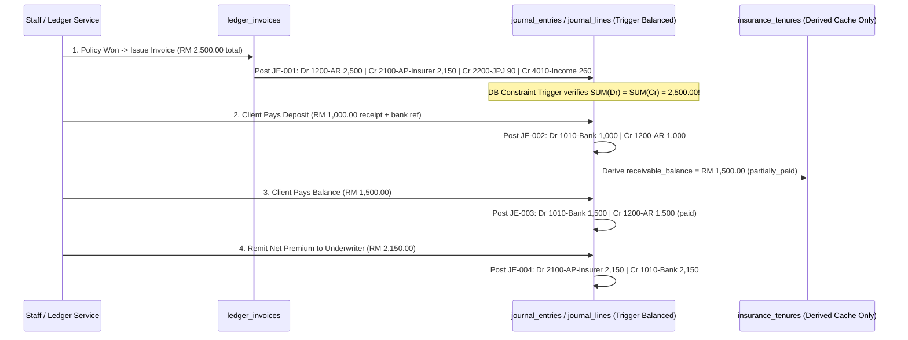

# Domain Module Audit: Financial Ledger, Invoices & Double-Entry Accounting Invariants

> **Module Scope**: Motor Renewal & Financial Ledger (`/ledger`, [`tables.py`](file:///c:/Users/mahmud/Desktop/Code/risklocker/quote_risklocker/backend/app/models/tables.py), `client_record_service.py`, `insurance_tenure_service.py`, `quotation_activity_service.py`, [`tenure-timeline-ledger.tsx`](file:///c:/Users/mahmud/Desktop/Code/risklocker/quote_risklocker/frontend/src/components/tenures/tenure-timeline-ledger.tsx)).

---

## 1. Why Current Code Is NOT a Real Financial Ledger

Right now, Risklocker calls `/ledger` the "Motor Renewal Ledger", **but there is zero financial accounting ledger inside the database!** Inspecting `tables.py` and `migrations/001`–`074` proves why:

1. **Money Tracked as Booleans (`tables.py:339-340`)**: On `InsuranceTenure`, settlement state is reduced to two booleans:
   - `client_payment_received: Mapped[bool]`
   - `agency_payment_done: Mapped[bool]`
   A boolean cannot tell you **how much** the client transferred (RM 1,500 deposit vs RM 2,840 full invoice), **when** they paid, which **bank reference / DuitNow slip** cleared, whether an **overpayment/refund/credit note** occurred, or whether there is an **RM 40 shortfall** between customer receipt and insurer remittance!
2. **Money Tracked as Plain Text (`tables.py:508-526`)**: `ClientRecord` stores all 14 financial figures (`coverage_amount`, `premium`, `roadtax`, `service_fee`, `total_premium`, `market_value`, `agreed_value`, `excess_amount`, `basic_premium`, `ncd_amount`, `service_tax`, `stamp_duty`, `gross_premium`) as **`String(100)`** (`varchar`)! You cannot guarantee precision, prevent commas/`"RM "` prefixes inside DB cells, or sum revenues atomically in SQL.
3. **Money Mapped as IEEE Floats (`tables.py:310-317, 377-389, 484`)**: `InsuranceTenure`, `TenureComparisonEntry`, and `QuotationActivity` wrap SQL `Numeric` columns as Python `Mapped[float]`, injecting IEEE-754 floating-point drift on 8% SST, stamp duty, commission splits, and multi-vehicle fleet invoices.
4. **Silent Swallowing & Mutability (`migrations/056, 061` + `workspace_patch_service.py:268`)**: Historical issued records lack database immutability enforcement, and pricing errors silently swallow exceptions instead of failing closed.
5. **Monolith Ledger UI (`tenure-timeline-ledger.tsx` `3,974L`)**: Operates primarily as a stage-tracking CRM table mixed with ad-hoc payment checkboxes rather than a reconciled operational + financial system.

---

## 2. How This Breaks in Enterprise Production

| Production Scenario | What Happens Today | Enterprise Audit Failure |
| :--- | :--- | :--- |
| **Partial Client Payment / Deposit** (Client pays RM 1,000 now, RM 1,850 next week) | Staff either ticks `client_payment_received=True` early (falsely marking paid in full!) or leaves it `False` (causing ops to chase a paying client). | Unreconciled Accounts Receivable (`1200-AR`); broken cash-flow reporting. |
| **Post-Bind Endorsement / Canceled Policy** | Staff manually edits `won_premium` in place; prior history disappears with zero audit credit note. | No immutable audit log; monthly close figures retroactively shift! |
| **Sub-Agent Split & Insurer Remittance** (`sub_agent_name` `:334` + insurer net) | No table models payable-to-insurer (`2100-AP`) vs sub-agent commission payable vs agency net margin. | Accountant reconciles bank statements manually in Excel outside Risklocker. |
| **Analytics & Revenue Aggregation (`/insights` -> `ledger?tab=analytics`)** | Python/SQL attempts ad-hoc regex string cleaning or float sums on inconsistent strings/floats. | Management conversion/revenue dashboards disagree with actual Hong Leong Bank deposits. |

---

## 3. Target Double-Entry Accounting Model & Posting Lifecycle

Every first-year accountant learns the golden equation: **Assets = Liabilities + Equity** (`Debits = Credits`). In Postgres, every financial event generates an immutable `journal_entry` whose `journal_lines` strictly balance to zero (`SUM(debit) == SUM(credit)`).

### 3.1 Chart of Accounts (`ledger_accounts`)

| Account Code | Name | Type | Normal Balance | Operational Meaning |
| :--- | :--- | :--- | :--- | :--- |
| `1010` | Cash at Bank (Operating Account) | Asset | Debit | Cleared client DuitNow / FPX / bank transfers |
| `1200` | Accounts Receivable — Clients | Asset | Debit | Billed total awaiting collection from policyholder |
| `2100` | Accounts Payable — Insurance Underwriters | Liability | Credit | Net premium due to Etiqa / Lonpac / QBE / STMB |
| `2200` | Accounts Payable — JPJ Road Tax Pool | Liability | Credit | Collected road tax held to remit to JPJ / MyEG |
| `2300` | Client Deposits / Unapplied Credits | Liability | Credit | Overpayments or advance retainers before invoice bind |
| `4010` | Agency Motor Commission & Fee Income | Revenue | Credit | Underwriter commission + agency service/runner fees |
| `4090` | Discounts Allowed & Write-Offs | Contra-Rev | Debit | Approved quotation discounts (`quotation_discount`) |

### 3.2 Double-Entry Transaction Flow (`Bind -> Collect -> Remit -> Adjust`)

---

## 4. Non-Negotiable Accounting Rules & Migration Bridge

1. **Strict `NUMERIC(12,2)` & Python `Decimal` Everywhere**: Never store or pass money as `float` or `String(100)`. Replace SQLAlchemy `Mapped[float]` across `tables.py` with `Mapped[Decimal]`. Backfill `ClientRecord` string fields cleanly in migration `078`.
2. **Append-Only Immutability (`REVERSAL`, Never `UPDATE`/`DELETE`)**: Mistakes are corrected exclusively by posting a compensating reversal journal entry (`reverses_entry_id`) + replacement entry — preserving 100% Malaysian LHDN / audit trail compliance.
3. **Zero-Balance Enforcement Inside PostgreSQL**: A `DEFERRABLE INITIALLY DEFERRED` constraint trigger checks `SUM(debit_amount) = SUM(credit_amount)` at transaction `COMMIT`. Unbalanced writes roll back atomically!
4. **Compatibility Views for Booleans**: Keep `client_payment_received` and `agency_payment_done` temporarily as **computed read-only properties/SQL views** (`outstanding_ar == 0`, `outstanding_ap == 0`) while decoupling `tenure-timeline-ledger.tsx` (`3,974L`) into clean CRM Timeline vs Financial Ledger tabs.

