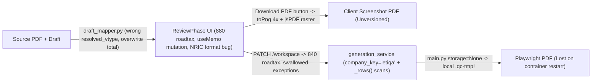

# Domain Module Audit: Quotation Workspace, Templates & Pricing Engine

> **Module Scope**: End-to-end Quotation Workspace (`/sessions/[id]`, exemplified by live session `4e7df9b1-395d-4c40-af05-bd1eb14b20c9`), template rendering, pricing rules, and PDF export pipeline (`generation_service.py`, `workspace_*`, `rendering/*`, `session-workspace/*`).

---

## 1. End-to-End Quotation Flow & Where Truth Diverges

Every arrow in that diagram represents a verified disconnect in `v30.1`. To a customer or staff member looking at session `4e7df9b1-...`, numbers, benefit sets, and rendered PDFs can silently disagree between what was extracted, what the Review form calculates, what Preview shows, and what gets archived to disk.

---

## 2. Detailed Defect Inventory (Workspace, Templates & Pricing)

### 2.1 Field Corruption & Form State Bugs (`review-phase.tsx` & `provider.tsx`)
1. **NRIC & Text Field Scrambling (`review-phase.tsx:192-208`)**: `displayValue(kind, value)` defaults unmatched `FieldKind` values (`"text"`, NRIC, references) into `formatCoverPeriod()`, running regex replacements `/(\d{4})-(\d{2})-(\d{2})/g -> "$3-$2-$1"` and `/(\d{2})\/(\d{2})\/(\d{4})/g -> "$1-$2-$3"` over non-date strings. Fix: isolate `"cover_period"` as its own `FieldKind` and return `"text"` verbatim.
2. **State Mutation Inside `useMemo` (`review-phase.tsx:1390-1402`)**: Directly assigning `formValues["vehicle_type"] = ...` inside `useMemo` mutates React state in place during render calculation without dispatching `setFormValues`, breaking dirty-state tracking and stale closures. Fix: pure selector derivation + explicit user-confirmed change event.
3. **Conflicting `880` vs `840` Client/Backend Road Tax (`provider.tsx:116` vs `policy-fields-card.tsx:251` vs `road_tax_engine.py:42`)**: Two React components in the same workspace compute different Peninsular Private Saloon rates (`>2500cc`). Fix: delete both frontend calculators and fetch debounced calculation from the backend JPJ engine.
4. **Misleading Total Payable Summary (`policy-fields-card.tsx:960-985`)**: Displays `Net Premium + Road Tax + Runner Fee = Total Payable`, hiding active paid optional add-ons (`extras`) and quotation discounts while `generation_service.py` includes `extras` in `adjusted_total_text`. Fix: explicitly show line items `Base Net Premium + Optional Paid Add-Ons + Road Tax + Runner Fee - Agency Discount = Total Payable`.

### 2.2 Benefit Resolution & Generation Blocker Contradictions
1. **Insurer Slug Bug -> Always `"etiqa"` (`generation_service.py:351`, `workspace_snapshot_service.py:264`)**: Reads `getattr(company, "company_key", "") or "etiqa"`. Since `InsuranceCompany` (`tables.py:104`) only defines `slug` (`"qbe"`, `"lonpac"`, `"stmb"`, `"amassurance"`, `"berjaya-sompo"`), every single quotation falls back to `"etiqa"` formula rules!
2. **4+1 Benefit Table Sprawl + Dual `CANONICAL_24_CATALOG`**: Design 2 benefits live partly in `benefit_concepts`/`catalog_offerings`, partly in `benefit_profiles`/`company_benefit_conditions`, partly in `global_benefit_profiles`, and partly in two manually-synced arrays (`unified_addon_engine.py:14` and `unified-addon-engine.ts:29`) with 24 hardcoded slots (leaving zero dynamic DB configuration without code redeploys).
3. **Broken Blocker Contract (`workspace_common.py:241-250` vs `generation_service.py:494`)**: `generation_blockers()` emits `scalar_check_needed` for unconfirmed scalars, keeping sessions pinned in `"check_needed"`, yet `request_version_generation()` filters out `scalar_check_needed` and allows generation anyway!
4. **Hardcoded Demo Element IDs (`generation_service.py:260-265`)**: Binds system logo/QR assets to brittle canvas IDs like `"text_ltaa394"`, `"text_ul2w5ka"`, and `"rc_b_qr_code"`. Fix: require semantic `assetSlot` enums (`"risklocker_logo"`, `"insurer_logo"`, `"bank_qr"`, `"whatsapp_qr"`) on schema validation.

### 2.3 Preview, Builder & PDF Rendering Fractures
1. **Raster `jsPDF` Download in Review (`review-phase.tsx:2137-2188`)**: Generates an uncompressed 4x PNG screenshot PDF locally while firing async backend archive in the background (`catch` logged only to browser console!).
2. **Fake Static `<svg>` Fallback (`preview-phase.tsx:607-743`)**: All non-Design-2 templates bypass the user's Builder design and draw a static `<svg>` that truncates after ~13 benefits (`y={304 + idx * 56}`).
3. **Production PII Fallbacks Across Renderers (`template_renderer.py:782-787`, `template_renderer_design2.py:114-130, 446-448`, `design2-canvas.tsx:267-282, 585-587`, `builder/templates/[id]/builder/page.tsx:95-117`)**: Real names, plates, and Hong Leong Bank details (`12300318500`) substitute silently when fields are missing.
4. **Embedded Worker Storage Bypass (`main.py:82` + `render_worker.py:195-217`)**: Because `storage=None` is passed by the embedded worker thread, `if storage is not None:` fails 100% of the time in production, dropping PDFs in `.qc-tmp/stateless_generated/` instead of private Supabase Storage!
5. **Squished 3-Column Benefit Manager & Native Dialogs**: `benefits-manager-panel.tsx:234` forces `lg:grid-cols-3` whenever add-ons exist; `review-header.tsx:69-85` uses `window.confirm`, `window.alert`, and `window.location.reload()`.

---

## 3. Target Architectural Cure for Quotation Workspace

1. **Unified Workspace Read Model (`GET /api/sessions/{id}/workspace`)**: Returns normalized `fields` (explicit `kind`, `value`, `detected_value`, `verification_state`), server-computed `pricing_breakdown` (`Decimal`), `benefit_cards` (resolved strictly via `company.slug` and DB `benefit_concepts` + `company_benefit_rules`), and authoritative `blockers`.
2. **Unified HTML/PDF Pipeline**: Delete `jsPDF` raster capture and static `<svg>` preview. Both Preview (`<iframe>` / sanitized HTML view) and Download PDF invoke the exact same `RenderSnapshot` -> pooled Playwright Chromium -> verified Supabase Storage pipeline.
3. **Explicit Blocker Discipline**: Every genuine extraction uncertainty (`valuation_type` unclear, negative/mismatched premium breakdown, unknown benefit cost) blocks final generation with an actionable 1-click "Verify & Confirm" chip right next to the field — zero silent `"ready"` overrides and zero ignored `scalar_check_needed` warnings.
4. **Ergonomic Workspace UX**: Tabbed left review panel (`Details` | `Pricing` | `Benefits`) with >=40px controls and a single sticky right-hand Design 2 / Custom HTML preview pane with Sheet 1 / Sheet 2 toggle and accessible `<ConfirmDialog>` modals.

