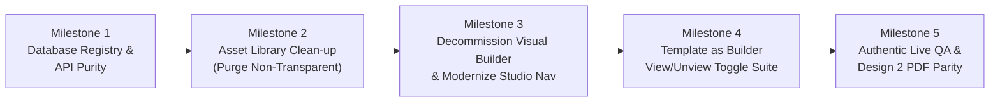

# Design 2 Precision, "Template as Builder" & Studio Modernization Plan

> **Document:** `docs/plans/2026-11-15-design2-precision-and-builder-consolidation-plan.md`  
> **Date:** 2026-11-15  
> **Status:** Pending Review / Ready for Execution  
> **Standards:** `Rule 06`, `Rule 02`, `Rule 03`, `/writing-plans`, `/subagent-driven-development`, `/verification-before-completion`  
> **Goal:** Fulfill the complete serial chronicle specification (`USER-CHRONICLE-IDEA-SPEC.md` Steps 1–3) by decommissioning the obsolete drag-and-drop block builder, archiving 12 legacy ghost templates, purging 106 non-transparent assets, elevating structured view/unview toggle controls ("Template as Builder"), and locking the system strictly to **Design 2 (Modern 4-Column Grid)** with exact 1:1 A4 PDF parity.

---

## 1. Executive Summary & Historical Grounding

### The User Chronicle Contract (Idea Spec Steps 1–3)
In the permanent serial idea record ([`docs/history/USER-CHRONICLE-IDEA-SPEC.md`](file:///c:/Users/mahmud/Desktop/Code/risklocker/quote_risklocker/docs/history/USER-CHRONICLE-IDEA-SPEC.md#L13-L74)):
1. **The Builder Dilemma (Messages #1 & #2)**:
   > *"The drag-and-drop block designer / template builder is over-complicated, clunky, and unnecessary. Design 2 (Modern 4-Column Grid) is 99.9% perfect, looks awesome, and is accepted by the company. Do we really need the quotation designer or builder or not? It is complicating things more. Rather, what if we use a fixed template of coding where we can automatically generate code and the template changes accordingly?"*
2. **Template as the Builder (Message #3)**:
   > *"Instead of having separate database templates for variations, have ONE single template, but on the motor quotation page we have an option directly of what to hide or what to do. Think like the template itself is the builder. On the quotation page we do things directly."*
3. **Design 2 Fixed 24 Matrix & Asset Purity (Messages #4 & #5)**:
   > *"Design 2 has a fixed 24 benefit cards matrix (A4 boundary: 6 rows × 4 columns). Dynamic in-place Towing upgrade + duplicate generic towing suppression... Keep only transparent assets, remove background mess."*

### Why the User Found the System Disconnected Today:
1. **The 14 Ghost Templates**: Although the quotation review dropdown was filtered in Milestone 5, the admin template manager at `http://localhost:3000/builder/templates/quotation-templates` calls `GET /api/admin/templates` ([`templates.py:838`](file:///c:/Users/mahmud/Desktop/Code/risklocker/quote_risklocker/backend/app/api/routers/templates.py#L838)), which ran an unfiltered `OutputTemplateConfig.deleted_at.is_(None)` query, flooding the screen with 12 unmigrated legacy variants (`FinTech Neo-Broker v28`, `v3`, `v3 (No Extras)`, `v4 (No Extras)`, duplicates).
2. **The Obsolete Coordinate Builder**: Clicking "Edit in Builder" still routed to `/builder/templates/[id]/builder` ([`page.tsx`](file:///c:/Users/mahmud/Desktop/Code/risklocker/quote_risklocker/frontend/src/app/builder/templates/[id]/builder/page.tsx)), an old Canva/Figma-style block coordinate editor that does not understand Design 2 and tries to compile it into generic blocks, losing all modern grid styling.
3. **The Benefit Presets Illusion**: `/builder/templates/benefit-templates` and the "Benefits Card Template" preset buttons (`Masonry Flow`, etc.) in `TemplateConfigCard.tsx` only affected the obsolete SVG `<g>` grid. Design 2 uses a mathematically fixed 24-card CSS/HTML grid with built-in vector SVG icons, ignoring these presets completely.
4. **Asset Library Clutter**: In `http://localhost:3000/builder/assets`, 106 non-transparent raster JPGs (`Global benefits v2 2d` and `Global Benefits 3D v1`) cluttered the library, despite Design 2 rendering razor-sharp native vector icons (`render_design2_icon_svg`) without needing bitmap art.
5. **Hidden View/Unview Controls**: The user wanted high-level switches to enable/disable or view/unview document components (Extras Breakdown, Road Tax, Runner Fee, Schedule Page 2, Bank QR, Policy Excess), but these were either scattered or hidden.

---

## 2. 10-Point Edge-Case & Failure-Mode Matrix

| ID | Dimension | Failure Mode Prevented |
| :--- | :--- | :--- |
| **E-01** | Legacy Template Leaks | Unarchived templates (`FinTech Neo-Broker`, `v3`, copies) appearing in admin lists or being accidentally pinned to new quotations. |
| **E-02** | Coordinate Builder Desync | Staff opening Design 2 in `/builder/templates/[id]/builder` and having the block compiler overwrite Design 2's locked 24-card matrix config. |
| **E-03** | Dead Preset Buttons | Staff clicking `Masonry Flow` or `Compact List` buttons in `TemplateConfigCard` expecting Design 2 cards to change, leading to confusion and bug reports. |
| **E-04** | Missing Insurer Logo Fallback | When an underwriter lacks an asset or the asset fails to load, Design 2 renders optical bold typography instead of a broken `` icon. |
| **E-05** | View/Unview Concurrency & State | Toggling "Hide Extras" or "Hide Road Tax" updates `display_options` in workspace state instantly via `queueOperation` and recalculates A4 canvas height without page reload. |
| **E-06** | 304 Not Modified Proxy Crash | Asset endpoints returning HTTP `304` or `204` do not crash the Next.js API proxy (`route.ts:79-85`) with `TypeError: Response constructor`. |
| **E-07** | Background Asset Pollution | Benefit icons with solid white or grey backgrounds rendering as ugly boxes on clean white cards; only clean vector SVGs or verified transparent PNGs render. |
| **E-08** | Dynamic Towing In-Place Parity | Selecting a paid towing rider (`OTO 360`, `Motor PA Plus Plan 4`) upgrades the top card to `UNLIMITED TOWING ASSISTANCE` and suppresses duplicate unselected towing in the 24 matrix. |
| **E-09** | 24-Card Matrix Overflow | High-load quotations with >24 benefits gracefully overflow to Benefit Schedule Page 2 rather than squashing or clipping on Page 1. |
| **E-10** | Single Source of Truth Math | Toggling Road Tax or Runner Fee off does not recalculate totals in React; the backend `Decimal` snapshot provides authoritative net and gross sums. |

---

## 3. Serialized Milestone Architecture



---

### Milestone 1: Database Registry & API Purity (Purge Ghost Templates)

- [ ] **Task 1.1: Author Database Archive Migration / Script for Legacy Templates**
  - **Files:** `backend/app/services/master_template_service.py`, `scripts/archive_legacy_templates.py` (or migration script)
  - **Action:** Soft-delete and archive all historical templates in `output_template_configs` except:
    1. `b78e2024-0002-4000-8000-000000000002`: **`Design 2 (Modern 4-Column Grid)`** (`layout_engine: "design2"`, `is_default: True`, `status: "active"`)
    2. `72af8553-b1ec-439c-ad71-5402d4f467a3`: **`Bilingual Agency Motor (Design 1)`** (`layout_engine: None`, `is_default: False`, `status: "active"`, legacy fallback)
  - Set `deleted_at = func.now()`, `status = "archived"` on the remaining 12 templates (`agency_bilingual_v3*`, `agency_bilingual_v4_no_extras`, `agency_bilingual_v4_lump_sum`, `FinTech Neo-Broker*`, `Agentic Master Quotation*`).
  - **Verification:** Query `select count(*) from output_template_configs where deleted_at is null` returns exactly **2**.

- [ ] **Task 1.2: Filter Admin Templates API (`GET /api/admin/templates`)**
  - **Files:** `backend/app/api/routers/templates.py:838-855`
  - **Action:** Update `admin_templates()` query to strictly filter:
    ```python
    OutputTemplateConfig.deleted_at.is_(None),
    OutputTemplateConfig.status == "active"
    ```
    Ensure it returns only the 2 active canonical templates, with Design 2 sorted first as default.
  - **Verification:** Unit test asserting `GET /api/admin/templates` returns exactly 2 records, with Design 2 having `is_default: True`.

---

### Milestone 2: Asset Library Purity, 2D Auto-Mapping & Hybrid Card Renderer

- [ ] **Task 2.1: Purge / Soft-Delete 106 Non-Transparent Background Assets**
  - **Files:** `backend/app/models/tables.py`, database cleanup script / service
  - **Action:**
    - Query `business_assets` where `category in ('Global benefits v2 2d', 'Global Benefits 3D v1')` or `has_transparency == False` (106 items).
    - Remove or soft-archive these items from active asset queries so they no longer appear in `/builder/assets`.
    - Retain strictly:
      1. `global benefits v3 2d no bg` (63 verified transparent 2D icons)
      2. `Logos` (8 transparent company/insurer logos)
      3. `General` (11 core assets: Risklocker logo, DuitNow QR, etc.)
  - **Verification:** `GET /api/business/assets` returns 0 assets with solid backgrounds; total active assets = ~82 clean transparent assets.

- [ ] **Task 2.2: Automated 2D Numbered Asset-to-Concept Re-mapping Engine**
  - **Files:** `backend/app/services/benefit_concept_service.py`, `scripts/map_v3_assets_to_concepts.py`
  - **Action:**
    - The 63 uploaded 2D transparent assets are numbered systematically (`1_own-damage.jpg`, `6_towing.jpg`, `10_betterment-protection.png`, `14_first-loss-flood.png`, `26_windscreen.jpg`, etc.).
    - Write a deterministic migration script that re-maps `BenefitConcept.default_asset_id` from the obsolete 3D images (`Global Benefits 3D v1`) to the corresponding `global benefits v3 2d no bg` asset IDs.
    - Eliminate the need for staff to manually upload and hand-assign assets one-by-one.
  - **Verification:** Query asserting >=60 `BenefitConcept` rows point directly to active `global benefits v3 2d no bg` asset IDs.

- [ ] **Task 2.3: Hybrid Design 2 Card Renderer (2D Transparent Image with Vector SVG Fallback)**
  - **Files:** `frontend/src/components/template-canvas/design2-canvas.tsx:650-675`, `backend/app/rendering/template_renderer_design2.py:200-225`
  - **Action:**
    - In both the React live canvas and backend Playwright PDF renderer:
      - Inspect whether the benefit card has an assigned 2D image asset URL (`card.asset_url` / `concept.default_asset.url`).
      - If present: render the high-resolution 2D transparent PNG (``).
      - If absent: cleanly fall back to the built-in vector SVG icon (`render_design2_icon_svg(icon_hint, size=38)` / `<Design2BenefitIconSvg />`).
    - This gives the customer the beautiful 2D artwork they uploaded while maintaining 100% fail-closed vector stability.
  - **Verification:** Both live canvas and generated PDF show the crisp 2D transparent icons on cards where assets exist, and clean SVGs elsewhere.

- [ ] **Task 2.4: Asset Library UI Modernization (`/builder/assets`)**
  - **Files:** `backend/app/services/business_asset_service.py:63-85`, `backend/app/api/routers/templates.py:407-427`, `frontend/src/app/builder/assets/page.tsx`
  - **Action:**
    - **Backend API additions:**
      - Add `sort_by: "created_at" | "label"` (default: `"created_at"`).
      - Add `sort_order: "asc" | "desc"` (default: `"desc"` so latest uploaded shows first!).
      - Add `is_transparent: bool | None` filter.
      - Add `usage: "all" | "assigned" | "unassigned"` filter.
      - Include `mapped_concept_names: list[str]` in asset summary so staff see which benefit uses each asset.
    - **Frontend UI additions:**
      - Add **Sort Dropdown:** `[ Newest First | Oldest First | Name A-Z | Name Z-A ]`.
      - Add **Transparency Filter Pill:** `[ All | Transparent Only | Solid Background ]`.
      - Add **Usage Filter Pill:** `[ All | In Use | Unassigned ]`.
      - Add visual badge on each asset card: e.g. `Used in: Windscreen, Special Perils` or `Unassigned`.
      - Relax overly strict duplicate upload rejection rules into smooth overwrite/replace options.
  - **Verification:** Navigating to `/builder/assets` allows 1-click filtering by newest uploaded, transparent only, and clearly shows which asset is used where.

---

### Milestone 3: Decommission Obsolete Drag-and-Drop Builder & Modernize Studio Navigation

- [ ] **Task 3.1: Modernize Sidebar & Header Navigation (`app-shell.tsx`)**
  - **Files:** `frontend/src/components/app-shell.tsx:61,412-416`
  - **Action:**
    - Rename sidebar item `"Builder"` to **`"Catalog Studio"`** (or `"Studio"`), updating the icon to `SlidersHorizontal` or `Storefront`.
    - Set primary route to `/builder/benefits` (the Underwriter Catalog & Peril Studio where staff manage underwriter catalogs, packages, and Copilot diff plans).
  - **Verification:** Visual check that sidebar shows "Catalog Studio" and directs to the active catalog manager.

- [ ] **Task 3.2: Modernize `builder-nav.tsx` & Decommission Dead Sub-Routes**
  - **Files:** `frontend/src/components/builder-nav.tsx`, `frontend/next.config.mjs`
  - **Action:**
    - Update `BuilderNav` tabs to:
      1. `Templates` (`/builder/templates/quotation-templates`)
      2. `Benefits & Catalogs` (`/builder/benefits`)
      3. `Insurance Companies` (`/builder/companies`)
      4. `Asset Library` (`/builder/assets`)
    - Remove dead tabs: `Global Benefits` (redirect to `/builder/benefits`), `Upload Limits` (redirect to `/settings/system`).
    - In `frontend/next.config.mjs`, add permanent redirects:
      - `/builder/templates/:id/builder` $\rightarrow$ `/builder/templates/quotation-templates`
      - `/builder/templates/benefit-templates` $\rightarrow$ `/builder/templates/quotation-templates`
      - `/builder/templates/benefits` $\rightarrow$ `/builder/benefits`
      - `/builder/global-benefits` $\rightarrow$ `/builder/benefits`
  - **Verification:** Navigating to `/builder/templates/.../builder` redirects cleanly without crashing.

- [ ] **Task 3.3: Refactor `/builder/templates/quotation-templates` into Clean Template Showcase**
  - **Files:** `frontend/src/app/builder/templates/quotation-templates/page.tsx`
  - **Action:**
    - Remove the `"Edit in Builder"` button that opened the broken coordinate canvas.
    - Display the 2 canonical cards:
      1. **`Design 2 (Modern 4-Column Grid)`** — Marked as "Primary Default · 100% Vector HTML/PDF Engine". Includes "Preview Full A4" dialog and direct link to sample quotation.
      2. **`Bilingual Agency Motor (Design 1)`** — Marked as "Legacy Compatible Engine".
    - Provide a clean "Template Settings" view with default view/unview toggles instead of free-drag coordinate manipulation.
  - **Verification:** Page loads cleanly, displaying only the 2 official templates with zero dead builder links.

---

### Milestone 4: "Template as Builder" — Comprehensive View/Unview Toggle Suite

- [ ] **Task 4.1: Eliminate Misleading Benefit Presets from Review Phase**
  - **Files:**
    - `frontend/src/components/session-workspace/review-components/TemplateConfigCard.tsx:350-386`
    - `frontend/src/components/session-workspace/review-components/LivePreviewCard.tsx:150-162`
    - `frontend/src/components/session-workspace/review-components/useReviewCatalogAndTemplate.ts:74-95`
  - **Action:**
    - When active template is Design 2 (`isDesign2 === true`):
      - Completely hide the `"Benefits Card Template"` preset switcher (`Masonry Flow`, `Modern Grid`, `Compact List`) in `TemplateConfigCard.tsx`.
      - Hide the preset select dropdown from `LivePreviewCard.tsx`.
  - **Verification:** Review page shows zero irrelevant preset buttons when inspecting a Design 2 quotation.

- [ ] **Task 4.2: Build Unified "Quotation Section Controls" in `TemplateConfigCard.tsx`**
  - **Files:** `frontend/src/components/session-workspace/review-components/TemplateConfigCard.tsx`
  - **Action:**
    Add a dedicated, clean **"Document Visibility & Layout Controls"** section featuring clear toggle buttons:
    1. **Extras Mode:** `[ Itemized | Lump Sum | Hide Extras ]` (segmented control)
    2. **Road Tax:** `[ Show Road Tax | Hide ]` (toggles `workspace.display_options.include_road_tax`)
    3. **Runner Fee:** `[ Show Runner Fee | Hide ]` (toggles `workspace.display_options.include_runner_fee`)
    4. **Benefit Schedule (Page 2):** `[ Page 1 Only | Include Schedule Page 2 ]` (toggles `workspace.display_options.include_benefit_schedule`)
    5. **Bank & Payment QR:** `[ Show Bank QR | Hide ]` (toggles `workspace.display_options.show_payment_qr`)
    6. **Policy Excess Notice:** `[ Show Excess | Hide ]` (toggles `workspace.display_options.show_excess`)
  - Each toggle directly commits to `workspace.display_options` via `queueOperation` and immediately updates the live canvas preview without page reload.
  - **Verification:** Clicking any toggle immediately updates the live canvas and persists into the workspace snapshot.

- [ ] **Task 4.3: Ensure 1:1 Parity in Backend Playwright Vector Renderer**
  - **Files:** `backend/app/rendering/template_renderer_design2.py`
  - **Action:**
    Verify that `template_renderer_design2.py` reads all `display_options` flags:
    - `show_payment_qr == False` $\rightarrow$ cleanly omits DuitNow QR box while keeping agency bank details aligned.
    - `show_excess == False` $\rightarrow$ suppresses the Excess callout pill.
    - `include_road_tax == False` $\rightarrow$ omits Road Tax line and calculates Net Payable accordingly.
    - `include_runner_fee == False` $\rightarrow$ omits Runner Fee line.
    - `include_benefit_schedule == True` $\rightarrow$ appends Page 2 Benefit Schedule via `benefit_schedule_renderer.py`.
  - **Verification:** Playwright PDF rendering test verifying that toggled sections are included or excluded in generated PDF vector output.

---

### Milestone 5: Authentic End-to-End Verification & Gate Sign-off

- [ ] **Task 5.1: Backend Test Suite & Purity Assertions**
  - **Command:** `pytest tests/unit/ tests/integration/`
  - **Assertions:** All template consolidation, dynamic towing, and betterment math tests pass 100%.

- [ ] **Task 5.2: Frontend TypeScript & Lint Compilation**
  - **Command:** `cd frontend; npx tsc --noEmit`
  - **Assertions:** Zero TypeScript errors across all routes and components.

- [ ] **Task 5.3: Live Operational Browser Traversal (`http://127.0.0.1:3000`)**
  - **Actions:**
    1. Visit `http://localhost:3000/builder/templates/quotation-templates`: Assert exactly 2 templates display, zero dead links.
    2. Visit `http://localhost:3000/builder/assets`: Assert 0 background JPGs, only transparent PNG/logos display.
    3. Open a live session `/sessions/[id]/review`: Assert Design 2 loads instantly, Risklocker logo loads with 200/304, section toggles (`Hide Extras`, `Include Road Tax`, `Page 2 Schedule`) dynamically update preview canvas without reload.
    4. Click "Download PDF": Assert generated vector PDF reflects exact toggle choices.

---

## 4. Blast Radius (Files Allowed & Forbidden to Change)

### Files Allowed to Change:
- `backend/app/api/routers/templates.py` (admin templates query filter)
- `backend/app/services/master_template_service.py` (canonical specs)
- `backend/app/rendering/template_renderer_design2.py` (display_options flag handling)
- `frontend/src/app/api/[...path]/route.ts` (proxy 304 fix — already completed)
- `frontend/src/app/builder/templates/quotation-templates/page.tsx` (clean template showcase)
- `frontend/src/components/builder-nav.tsx` (navigation consolidation)
- `frontend/src/components/app-shell.tsx` (sidebar Studio naming)
- `frontend/src/components/session-workspace/review-components/TemplateConfigCard.tsx` (unified view/unview toggle suite)
- `frontend/src/components/session-workspace/review-components/LivePreviewCard.tsx` (remove redundant preset switcher)
- `frontend/next.config.mjs` (clean redirects for retired builder sub-routes)

### Files Forbidden to Change:
- `backend/app/domain/motor/` (authoritative Decimal pricing and cash rounding)
- `backend/app/services/road_tax_engine.py` (authoritative JPJ road tax formulas)
- `backend/app/extraction/` (Gemini Flash-Lite pipeline & pacer sentinel)
- `migrations/` (historical migrations 001..077 are frozen)

---

## 5. Review & Approval

Please review this comprehensive plan. Once approved, we will begin executing Milestone 1 immediately using `/subagent-driven-development` with authentic verification at every step.
