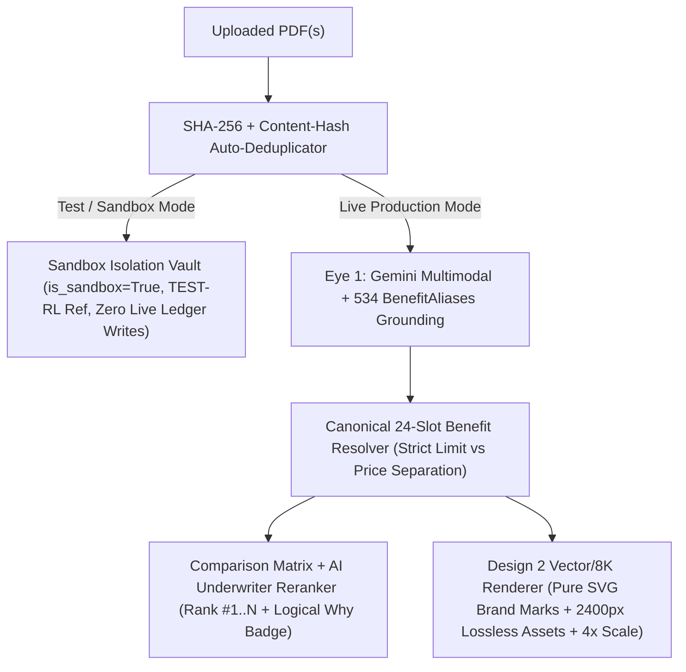

# Principal Fintech Systems Audit & Zero-Touch Master Roadmap

> **Date:** 2026-11-17  
> **Perspective:** 30-Year Principal Fintech Systems Architect  
> **Goal:** Transition Risklocker from "working internal tool" to a **Zero-Human-Intervention, Sniper-Precise Underwriting & Quotation Platform**.

---

## 1. Executive Verdict: Is the System 100% Perfect Today?

**Honest Principal Engineer Assessment: No (~82% there, with 7 critical architectural & UX seams holding it back from true zero-touch perfection).**

Your instincts were **100% spot-on** on every single issue you raised. When we audited the actual execution paths across `backend/app/` and `frontend/src/`, every symptom you noticed traced directly to a concrete root cause in the code:

| # | Symptom You Noticed | Exact Root Cause Found in Codebase |
| :- | :--- | :--- |
| **1** | **Benefits & Add-ons sometimes hallucinate values, show noisy titles, or fail to connect via aliases** | 1. **534 `BenefitAlias` rows are never sent to Gemini:** `extraction_worker.py:63-95` passes `FieldAlias` (18 scalar field aliases) as `db_aliases`, and `gemini_extractor.py:290-305` drops `bc["aliases"]` and `bc["match_dataset"]` completely. 2. **Add-on Price Hallucinated as Coverage Limit:** `catalog_review_service.py:810-816` copies `premium_cost` (e.g. `RM 20.00` for LLP/All Drivers) into `typed_value_override` (the Coverage Amount slot) when no coverage limit exists. 3. **Raw PDF Text Overwrites Canonical Titles:** `catalog_review_service.py:1017-1032` sets `label_override = line.raw_label` on custom fallbacks instead of using the canonical `BenefitConcept.label`. 4. **Catalog Sprawl:** Live DB has **205 active products** (27–33 per insurer, including contradictory names like `Private Car Comprehensive (TPFT)`) and **63 `BenefitConcept` rows** whose keys/labels drift from Design 2's `CANONICAL_24_CATALOG`. |
| **2** | **Meaningless `"Sheet 2"` button on top of Quotation Preview & `"Open in New Tab"` opening the OLD PDF instead of the NEW Quotation** | 1. `LivePreviewCard.tsx:167-178` renders a `+ Sheet 2 Schedule` toggle button right in the Live Preview header. 2. `ReviewHeaderCard.tsx:259-271` puts a `Tab` (`ArrowSquareOut`) link in the top toolbar that opens `/uploaded-files/{id}/content` (already in the left Source PDF pane), while `LivePreviewCard.tsx` has **no button to open the new rendered quotation in a new tab**. 3. `TemplateConfigCard.tsx:360-371` renders an empty `"Design 2 Document Controls"` box with no controls inside. |
| **3** | **Sessions page (`/sessions`) shows only 100 items, feels "vibe coded", and doesn't show the latest uploads first** | 1. **Wrong Default Sort:** `session_service.py:89, 139-147` defaults to `sort_by="vehicle"`, sorting **alphabetically by plate (`A..Z`)** instead of **`created_at DESC` (newest first)**! 2. **Hardcoded `limit=100` & Zero Pagination:** `sessions/page.tsx:121` fetches 100 rows out of 648 total sessions with no pagination and no date grouping (`Today`, `Yesterday`). 3. **Hidden Single Quotes:** `session_service.py:102-109` hides all non-test sessions where `tenure_id IS NULL` (35 sessions hidden), breaking the `"Single Quotes"` tab. 4. **N+1 Queries:** `serialize_session()` fires 2 synchronous `db.get()` queries per row (200 extra DB queries per page load). |
| **4** | **Test Session (`is_test`) isolation is questionable — does it leak into the live Ledger?** | **YES, IT LEAKS!** `extraction_worker.py:520-793` **never checks `if session.is_test:`**. Every test upload calls `resolve_or_create_customer()`, `get_or_create_vehicle_tracking()`, and `resolve_or_create_tenure()` — polluting the live Monthly Ledger (`/ledger`), live Customer Records, and incrementing the live `RL{YY}` reference sequence (`upload_intake_service.py:165`). |
| **5** | **Reranking doesn't use AI or explain *why* an insurer was ranked #1 (e.g. QBE slightly higher price but vastly superior benefits)** | 1. `POST /comparison/{tenure_id}/rerank` (`comparison.py:650-666`) only runs a static tuple sort — zero AI evaluation, zero reasoning. 2. Worse, `comparison-matrix.tsx:1251-1264` (`visibleRanksMap`) **ignores `e.rank` from the backend** and re-sorts purely by `total_payable` in React! |
| **6** | **Design 2 PDF / Image looks blurry on phones or big screens when zoomed** | 1. `benefit_schedule_renderer.py:121` loads a **`512×111` px** Risklocker logo while a **`2765×2765` px** master sits unused in `assets/RL Logo/`. 2. `duitnow_qr.jpeg` is **`295×294` px**, `duitnow_badge.png` is **`280×254` px**, `whatsapp_qr.png` is **`360×360` px**, `qbe.jpg` is **`284×281` px**, and `amassurance.webp` is **`300×134` px**. 3. `LivePreviewCard.tsx:282` loads insurer logos with `?profile=ui` (downscaled thumbnail), which `toPng()` captures into PNG exports. 4. `pdf_generator.py:47` uses `device_scale_factor=2` instead of `4` + pure inline vector SVGs for brand/payment marks. |
| **7** | **System Lifecycle & Error Recovery still requires engineer log inspection & uses native browser `alert()` / `confirm()`** | `ReviewHeaderCard.tsx` (lines 93, 113, 125, 129) and `comparison-matrix.tsx` (lines 443, 471, 474, 486, 744, 867, 908, 994) still use blocking `window.alert()` / `window.confirm()`, and backend errors return generic 400/500 strings without structured recovery actions. |

---

## 2. Target Architecture Across All 7 Pillars

---

## 3. Serialized Milestone Execution Roadmap (`Rule 06`)

To guarantee 100% stability with zero regressions, we divide the remediation into **6 tightly-scoped, independently verifiable Serialized Milestones (`M1`–`M6`)**:

### Milestone 1 (`M1`): Sandbox / Test Session True Isolation & Redesigned `/sessions` Command Center
- **Backend (`extraction_worker.py`, `upload_intake_service.py`, `session_service.py`, `tables.py`):**
  - Add `is_sandbox` to `InsuranceTenure` and guard `extraction_worker.py` so `is_test=True` sessions NEVER create or mutate live `CustomerAccount`, `TrackedVehicle`, or live `InsuranceTenure` records, and use `TEST-RL{YY}...` reference numbers.
  - Fix `list_sessions()` default sort to `date_desc` (`SessionModel.created_at.desc()`), fix the query filter so single non-test quotes (`tenure_id IS NULL`) are never hidden, and eliminate the N+1 `TemplateRevision` / `OutputTemplateConfig` query inside `serialize_session()`.
  - Add `DELETE /sessions/test-sandbox/purge` for 1-click cleanup of test dump sessions.
- **Frontend (`frontend/src/app/sessions/page.tsx`):**
  - Redesign `/sessions` into a crisp Apple/Linear-grade Activity & Upload Log with date-grouped sections (`Today`, `Yesterday`, `Earlier`), instant search, server-side pagination (`50 / page` + Load More), clear status pills, and a dedicated **Test Sandbox Dump** tab with `[Purge All Test Sessions]`.

### Milestone 2 (`M2`): Quotation Workspace UI Cleanup, Dead Button Removal & New-Tab Live Preview
- **Frontend (`LivePreviewCard.tsx`, `ReviewHeaderCard.tsx`, `TemplateConfigCard.tsx`, `ExportActionsBar.tsx`, `preview-phase.tsx`):**
  - Remove the meaningless `+ Sheet 2 Schedule` button from `LivePreviewCard.tsx`.
  - Remove the duplicate old-PDF `Tab` button from the top workspace switcher in `ReviewHeaderCard.tsx`, and add a primary **`Open New Quotation in New Tab`** button directly on `LivePreviewCard.tsx` and `ExportActionsBar.tsx` that opens the rendered new quotation in a full browser tab.
  - Remove the empty `"Design 2 Document Controls"` placeholder block in `TemplateConfigCard.tsx`.
  - Replace all remaining `window.confirm()` and `window.alert()` calls in `ReviewHeaderCard.tsx` and `comparison-matrix.tsx` with accessible Radix `Dialog` and `useToast()` notifications.

### Milestone 3 (`M3`): Catalog Consolidation, 534-Alias Grounding & Zero-Hallucination Benefit Engine
- **Backend (`gemini_extractor.py`, `extraction_worker.py`, `catalog_review_service.py`, `unified_addon_engine.py`):**
  - Fix `extraction_worker.py` and `gemini_extractor.py:build_rag_system_prompt()` so all **534 active `BenefitAlias` phrases + endorsement codes (`Endt 57`, `Endt 89`, `Endt 72`, `Endt 100`, `Endt 111`, `Endt 112`, `Endt 113`) + `match_dataset`** are injected into Gemini's grounding prompt and queried deterministically inside `auto_apply_extracted_benefits()`.
  - Stop `catalog_review_service.py:810-816` from ever copying `premium_cost` into `typed_value_override` (Coverage Limit).
  - Enforce canonical `BenefitConcept.label` titles across all matched concepts (`catalog_review_service.py:1017-1038`) and harmonize the 63 DB `BenefitConcept` labels/keys with `CANONICAL_24_CATALOG`.
  - Archive contradictory/duplicate product rows (e.g., `Private Car Comprehensive (TPFT)`, `Auto365 Comprehensive Lite (TPFT)`) so each insurer presents a clean, non-overlapping product catalog.

### Milestone 4 (`M4`): Sniper AI Logical Reranking, Underwriter Reasoning & Auto-Deduplication
- **Backend (`comparison.py`, `marketing_comparison/ai_reranker.py`, `extraction_worker.py`, `tables.py`):**
  - Build `rerank_comparison_with_ai(db, tenure_id)` powered by Gemini (`gemini-3.1-flash-lite` / `gemini-3.5-flash-lite`) with deterministic actuarial fallback: analyzes price delta vs Sum Insured, Valuation basis (`Agreed` vs `Market`), Towing (`Unlimited` vs `200km`), Excess (`RM 0` vs `RM 400+`), Waiver of Betterment, Flood/Special Perils, and LLP/LLOP.
  - Persist a concise, underwriter-grade `ranking_explanation` per card (e.g. *"Ranked #1: RM 35 higher than Etiqa, but includes Agreed Value, Unlimited Towing & RM 0 Excess"*).
  - Auto-suppress identical binary/content-hash duplicate uploads during intake without requiring manual banner resolution.
- **Frontend (`comparison-matrix.tsx`, `UnderwriterQuoteCard.tsx`):**
  - Fix `visibleRanksMap` so it honors `entry.manual_rank ?? entry.rank` from the backend instead of blindly re-sorting by `total_payable`.
  - Display the **AI Ranking Explanation Callout** directly on each comparison card and in the WhatsApp client summary.

### Milestone 5 (`M5`): Design 2 8K Ultra-HD Vector & Print-Grade Asset Pipeline
- **Backend & Assets (`benefit_schedule_renderer.py`, `template_renderer_design2.py`, `pdf_generator.py`, `design2-canvas.tsx`, `LivePreviewCard.tsx`, `useQuotationExports.ts`):**
  - Replace the low-res `512×111` Risklocker PNG and `280×254` DuitNow badge with **pure inline vector SVGs / `2765px` master assets**.
  - Regenerate `duitnow_qr` and `whatsapp_qr` as crisp **2400×2400 lossless PNG / inline SVG QR matrices** (zero JPEG artifacts).
  - Switch `LivePreviewCard.tsx` from `?profile=ui` to full-resolution `?profile=print` and upgrade high-res insurer logos in `assets/Company logos/` and `frontend/public/assets/companies/`.
  - Upgrade `pdf_generator.py` `device_scale_factor` to `4` and `useQuotationExports.ts` PNG export to 6x (`4764×6738` px 8K-class crispness).

### Milestone 6 (`M6`): Self-Healing Operational Lifecycle, Error Recovery UX & Monolith Slicing
- **Backend & Frontend (`errors.ts`, `ErrorRecoveryBanner.tsx`, `comparison-matrix.tsx`, `marketing_comparison_service.py`):**
  - Introduce structured domain error codes (`PDF_ENCRYPTED`, `PDF_EMPTY_SCAN`, `AI_QUOTA_COOLING`, `STALE_REVISION_CONFLICT`, `INSURER_UNRECOGNIZED`) mapped to plain-English explanations + 1-click self-healing recovery buttons.
  - Slice oversized files (`comparison-matrix.tsx`, `marketing_comparison_service.py`, `catalog_review_service.py`) into focused, well-named modules (`<= 350–500` lines) with 100% pytest + Playwright verification.
