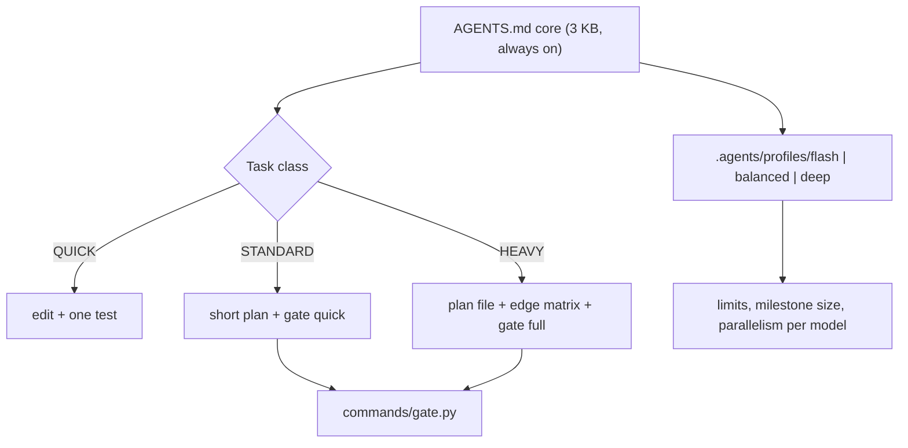

# Agent System Reset: Master Plan

> **Status:** Draft, awaiting owner approval. Nothing in `.agents/`, `AGENTS.md` or `docs/core/` has been changed.
> **Goal:** Replace the Flash-era rule set with a small core plus three model profiles, so Argon, Hydrogen, Claude and Gemini 3.8 Flash each work at full strength without long, confusing process.

Files in this folder:

| File | Content |
| :-- | :-- |
| `01-audit-findings.md` | What is wrong now, with evidence |
| `02-core-contract-and-model-profiles.md` | Draft text of the new `AGENTS.md` and the 3 profiles |
| `03-prune-and-migration-spec.md` | File-by-file keep, merge or delete list, `gate.py` spec, rollback |

## 1. Summary of the problem

1. About 28 KB of always-on text, much of it repeated and some of it contradictory (F2, F3).
2. No size tiering, so a one-line fix runs the same ceremony as a ledger change (F1).
3. The process lives in prose that a model must remember, not in a command (F5).
4. Built for one model. The 250K handover number, "Flash rigor mode" and the verification load do not fit a 100K-effective model, and they hold back Argon and Hydrogen (F7).
5. About 1.2 MB of dormant material (disabled hooks, logs, a 96-skill vault, nine role agents) that adds confusion and no value.
6. Large reads: `STATE.md` 42.8 KB and `START-HERE.md` 23.3 KB. One read costs Flash about 10K tokens.

## 2. Target design

Six logics, in the core:
1. **Classify** the task: QUICK, STANDARD or HEAVY.
2. **Ground** every claim in code you read this session, with `path:line`.
3. **Invariants**: eight one-line rules that protect money, data and security.
4. **Stop and ask** on ambiguity, destructive actions, scope growth, or two failed fixes.
5. **Gate by command**: `gate.py quick` or `full` replaces the prose gauntlet.
6. **Context limit per model**: handover at the number in your profile.

Per-model differences (details in file 02):

| | flash | balanced | deep |
| :-- | :-- | :-- | :-- |
| Models | Gemini 3.8 Flash | Claude Sonnet and Opus 5.5, GPT-OSS | Gemini 4 Argon, Gemini 4 Hydrogen, Orchestrator |
| Task classes | QUICK, STANDARD | all | all |
| Milestone size | 300 lines, one subsystem | 600 lines | 1,200 lines or a whole subsystem |
| Subagents and swarm | No | Read-only research | Yes, parallel slices |
| Handover | about 40 tool calls | about 150K tokens | about 400K tokens |
| Reads | 200-line ranges | Targeted | Whole subsystems allowed |

The context numbers are estimates from your observations and the model descriptions. Milestone R5 replaces them with measured numbers.

## 3. Milestones

Per the existing milestone rule, run one, verify, then decide on the next. All five are small.

| # | Name | Changes | Size | Risk |
| :-- | :-- | :-- | :-- | :-- |
| R1 | Core contract and profiles | New `AGENTS.md`, `.agents/profiles/*`, delete rules 00, 01, 02, 04, 05, 06, trim rule 03, switch `OVH_SSH.local.md` to manual, tag `agents-legacy-2026-11-17` | About 12 KB of text written, 28 KB removed | Low. Text only |
| R2 | `gate.py` | commands/gate.py, tests/unit/test_gate_selection.py | About 150 lines | Low |
| R3 | Prune harness | Delete 4 disabled hooks, logs, proposals. Merge 9 role agents into 4. Unmount 11 skills, trim and re-describe the rest | About 500 KB removed, mostly logs | Medium. CI references must be checked first (spec section 3) |
| R4 | Docs diet | `STATE.md` to 6 KB or less, `START-HERE.md` to 8 KB or less, new `AI-LIMITS.md`, update `verify-brain.py` | About 60 KB removed | Medium. `verify-brain.py` and `daily_radar.py` may assert on these files |
| R5 | Calibrate | Run 5 benchmark tasks on each of 4 models, record, tune profiles | One report | Low |

R1 and R2 are independent. R3 and R4 should come after R1, so the new core exists before the old rules go.

Dependency on the product roadmap: the combined roadmap (M4a to M4d, M3c) does not depend on this reset. If you want the roadmap to run under the new rules, finish R1 and R2 first, which takes one short session. The roadmap's milestone sizes then follow the profile of the model you run it on, for example M4a on Argon in one session.

## 4. R5 benchmark tasks

Same five tasks for each model. Record tool calls, minutes, wrong claims found on review, and whether the gate passed.

| Task | Class | What it tests |
| :-- | :-- | :-- |
| B1 Change one label in a comparison card | QUICK | Overhead on trivial work. Target under 5 tool calls |
| B2 Fix the `dictionaries/learn` 422 (M4b item 4) | STANDARD | Test-first, grounding, small diff |
| B3 Fix Special Perils "Contribution" false match (M4a item 5) | STANDARD | Domain accuracy, no invented names |
| B4 Add Kurnia company (M4c) | HEAVY-small | Migration, resolver, tests |
| B5 Review a 300-line diff and list real defects | Review | Hallucinated findings count |

Pass rule for a profile: no invented identifiers on B2 and B3, gate passes, B1 under 5 tool calls.

## 5. Decisions needed from you

| # | Question | My recommendation |
| :-- | :-- | :-- |
| 1 | Delete old rules, or park them in the vault? | Delete. Git tag keeps them. Parked copies tempt agents to read them |
| 2 | Keep 4 role agents, or none? | Keep 4. They help the `deep` profile fan out. Delete any you never invoke after R5 |
| 3 | Hydrogen in `deep` or `balanced`? | `deep`. Move it after R5 if it does not hold up |
| 4 | Let Flash do STANDARD tasks? | Yes, with the Flash limits. HEAVY work goes to another model |
| 5 | Keep the live browser check on every UI change? | Yes for STANDARD UI work at one viewport. Full zoom matrix only on HEAVY |
| 6 | Treat the security audit as new-findings-only? | Yes. It reports 98 critical today, so zero is not a usable gate |

## 6. Risks

- **Rules alone cannot fix a weak model.** The profiles reduce Flash's load. They do not make it reliable on HEAVY work. Routing HEAVY work away from Flash is part of the fix.
- **Model self-identification.** The profile loads only if the agent reads the core. The core is always on, so this holds. If a model skips the profile step, the core alone is already Flash-safe.
- **Hidden dependencies.** `verify-brain.py`, `daily_radar.py`, `skills-manager.py` and CI may reference files this plan removes. Spec section 3 requires a repo-wide search before each deletion.
- **Unverified model facts.** Context sizes and strengths of Argon and Hydrogen are from your description. R5 measures them.

